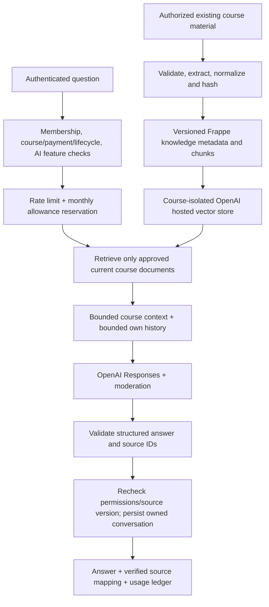

# SISU AI system and grounded learning flows

## Simple explanation

SISU first checks whether a user may use a feature and read a course. An authorized teacher indexes existing learning material. SISU retrieves relevant permitted text, asks the configured AI provider to use that evidence, validates its response and returns source references. Credit and token records explain what was spent. An AI answer is not a new grade or a published course assessment.



## Configuration and transport

Sources: `ai_provider.py`, `soul.py`, `soul_contract.py`, `ai_accounting.py`, `ai_rules.py`, `IL SOUL Settings`.

The provider reuses the existing encrypted SOUL API key and configuration. Generation model and moderation model are configurable. Retrieval currently supports OpenAI with a provider-managed embedding model; it does not expose arbitrary embedding model selection. Settings validate timeouts (5–60 seconds), maximum output (128–6000 tokens), model rates, feature credit units and bounded daily/document limits. Keys remain server-side and are never returned in the client contract.

Transport is restricted to approved `https://api.openai.com/v1/` Responses, moderation, Files and vector-store operations, with redirects disabled. Generation uses Responses, structured schemas and `store:false`, plus request identifiers and provider usage receipts. The hosted Files upload may use the API purpose string `assistants`; that purpose value does **not** mean SISU calls the deprecated Assistants/Threads architecture. Live compatibility and retention acceptance still require official-provider staging tests.

SOUL's platform helper remains separate from course learning tools. Existing student safeguards and prompt-safety policies are reused: age-appropriate educational assistance, no passwords/secrets/private contact requests, and course text treated as untrusted evidence rather than instructions. Moderation and schema checks can reject a provider result.

## Ingestion and indexing

Sources: `knowledge.py`, `ai_extract.py`, `storage.py`, `hooks.py`, `ai_retention.py`.

1. `knowledge.ingest(classroom, source_type, source_name)` requires a teacher/admin with permission to that classroom and `ai.rag`.
2. Valid source types are existing `IL Material`, `IL Session` text and mapped upstream `Course Lesson` text. Protected material is read through SISU's authorized local-file/storage adapter boundary; arbitrary remote URL fetching is not an ingestion shortcut.
3. PDF text, DOCX, PPTX and TXT extraction is implemented. Legacy DOC/PPT is unsupported/conversion-required. Image-only/scanned PDFs do not become successful text indexes without a text version; no OCR pipeline is claimed. Encrypted/unsafe/oversized material fails clearly.
4. Bounded extraction uses up to 10 MB, 200 pages/slides and 400,000 characters. OOXML archives/XML receive safety validation. Local chunking uses 1,800-character chunks, 180-character overlap and at most 300 chunks. Hosted indexing uses provider token chunking (800/150); these are different representations.
5. Hash/version and source metadata avoid duplicating unchanged documents. Changed source versions are reindexed; old versions are disabled/cleaned. Slow operations run in background jobs with locks/deduplication.
6. `IL Knowledge Document`, `IL Knowledge Chunk` and `IL Knowledge Index` preserve source references, version/status and server-only provider identifiers. OpenAI file/vector-store resources belong to a course index on one site. A provider ID never grants SISU access.
7. Source update/trash hooks invalidate knowledge. Query-time checks also require a current, enabled, Ready source and permitted course, so revocation is not dependent only on eventual provider deletion. Cleanup failures remain unconfirmed rather than being silently declared deleted.

The implemented retrieval adapter uses hosted vector-store search with a bounded result count (up to eight) and approved-document filters. There is no pgvector dependency or MariaDB migration for vectors. Hosted external storage requires privacy review, configured review flags and provider acceptance; students additionally require `il_ai_hosted_student_reviewed`.

## Permission boundary

`ai_access.authorize` resolves `saas.require(feature)` and requires a genuine active site-local `IL Member` tied to the authenticated user. It rejects learning data on the control plane. System Manager convenience in other services does not provide AI content access. Teacher/admin generation additionally verifies classroom write/teaching authorization. Student read operations reuse paid enrollment/content access and lifecycle checks. Student safeguards apply on top.

An enrolled Course A student cannot select Course B merely by supplying an ID. A tenant's database contains only its own metadata; no cross-tenant knowledge search exists. Conversation reads are owner-only, including against teachers/admins. Retrieval metadata is a second filter, never the only permission check. Sources are rechecked after expensive work before a result is stored/returned.

## Each feature

| Feature | API and entitlement | Actual processing / result / limitation |
|---|---|---|
| Learning assistant / course Q&A | `ai.course_question`, `ai.chat`; `ai.assistant` + `ai.rag` | Explicit consent, course authorization, moderation, allowance, approved retrieval, bounded own history, structured grounded answer and citations; unsupported evidence is explicit |
| Explanation / simplification / examples | `ai.course_question` mode | Same course evidence boundary; mode changes instructional wording, not permissions |
| Summaries | `ai.summary`; `ai.summaries` | Authorized current document or bounded ready-source set; summary with source mapping; oversized context rejected |
| Notes | `ai.notes`; `ai.notes` | Structured study-note content based on authorized source versions; no auto-publication |
| Flashcards | `ai.flashcards`; `ai.flashcards` | Validated front/back/source objects; private draft/practice output |
| Practice questions | `ai.questions`; `ai.questions` | Validated MCQ/True-False/written structures and answer data for private practice; not automatically official papers |
| Official AI paper generation | `papers.generate`; `ai.quiz` plus existing paper product restrictions | Existing teacher workflow, provider/accounting refactor, structured validation; explicit review before `papers.publish` |
| Teacher quiz draft | `ai.teacher_assistant(task=quiz)` | Teacher/class checks plus task flags; draft in AI workspace, not automatic official paper creation |
| Semantic search | `ai.search`; `ai.search` | Authorized hosted retrieval returns material title, excerpt, section, relevance and source reference; no unrestricted global student search |
| Recommendations / practice needs | `ai.recommendations`; `ai.recommendations` | Deterministic evidence from actual own graded attempts; suggestions and matching material titles; no LLM needed for the basic engine |
| Teacher assistant | `ai.teacher_assistant`; `ai.teacher` and task-specific flags | Lesson plan, revision, explanation and quiz drafts from authorized content |
| Assignment feedback | `ai.assignment_feedback`; `ai.assignments` | Authorized submitted/graded attempt → bounded answer/file context → draft feedback; no grade mutation |
| Admin insights | `ai.admin_insights`; `ai.analytics` and local Admin | Deterministic course aggregates; optional provider explanation of those aggregates only; privacy threshold |
| Usage | `ai.status`, `ai.usage` | Own allowance/records; authorized tenant aggregate view; no conversation-body export through usage |

Frontend: `native/AIWorkspace.vue` contains Assistant, Study tools, Search, student Recommendations, staff Knowledge and Admin Insights. `native/Papers.vue` handles official AI papers and feedback review. Citations use `native/contracts.js` source normalization and protected material links. Rendering a link never bypasses `materials.content`.

## Detailed assistant request

`classroom, question, request_id, optional conversation, consent, mode` enter `ai.course_question`. The server validates length/mode/consent and course membership/access, AI flags, student policy and hosted-retrieval review. Accounting reserves configured units before provider work. Authorized current knowledge is searched; context and up to ten messages/12,000 history characters are bounded. The model receives source IDs and safety instructions. Output schema/source IDs are validated; citations map only to supplied sources. Course and source versions are checked again. Optional conversation messages and the usage result are persisted. The response carries `answer`, `supported`, `citations` and `sources` suitable for web/mobile display.

If evidence is insufficient, SISU returns an unsupported/insufficient-evidence result rather than inventing a course-specific answer. This is still a provider-backed feature requiring evaluation; unit tests cannot establish factual accuracy for all real documents.

## Detailed assignment feedback example

```mermaid
sequenceDiagram
  participant T as Authorized teacher
  participant P as Papers.vue
  participant B as ai.assignment_feedback
  participant A as AI provider / accounting
  participant G as papers.mark
  T->>P: Select submitted or graded attempt
  P->>B: attempt ID + stable request ID
  B->>B: papers.checked + ai.assignments + classroom permission
  B->>B: Validate attempt, answers and owned private attachment
  B->>A: Bounded question/submission context; reserve allowance
  A-->>B: Moderated structured feedback draft + usage
  B-->>P: draft_feedback; requires_teacher_review=true
  P-->>T: Display editable/reviewable suggestion
  T->>P: Explicitly decide final feedback and grade
  P->>G: Explicit grade/feedback save after teacher review
```

`papers.mark` is the separate grading service. In code the attempt must be Submitted or Graded. Attachment extraction requires the correct private `IL Paper Attempt` ownership and supported format, with a 10 MB extraction boundary and combined 18,000-character context limit. Unsupported content fails. The generation schema produces feedback rather than a silently authoritative score. No student can use this API to read another student's submission.

## Conversations, evidence and privacy

`create_conversation`, `conversations`, `conversation`, `archive_conversation` and `chat` use `IL AI Conversation`/`IL AI Message`. Lists and reads are owner-scoped; history is paged and bounded before provider use. Archive/deletion scheduling supports personal privacy even where content features lapse, subject to the actual ownership checks. Teachers/admins do not automatically inherit access. Source mappings are persisted separately from provider credentials.

Recommendations inspect recent graded attempts (bounded to 30) and actual incorrect objective answers, returning evidence tied to paper/question. Labels reflect question text/practice needs, not a fabricated topic mastery or intelligence model. Suggested materials use available matching titles, not a guarantee of pedagogical personalization. Insufficient assessment data is stated.

Admin insights require at least five distinct assessed students for the relevant aggregate; difficult-question reporting also applies a minimum cohort and bounded recent attempt sample. Weighted scores, attendance counts and AI usage come from deterministic data. Optional explanation sends those aggregates to the provider. No private conversation is included. Small cohorts return suppression rather than fabricated statistics.

## Credits, tokens, cost and retries

`ai_accounting.execute` uses per-site/user/feature/request identity, a validated stable request ID, payload hash, Redis lock and subscription-row locking. A reservation is committed before expensive calls. A succeeded retry returns its stored result; a changed payload under the same ID is rejected. New request IDs represent new work, not free retries.

Credits are configurable per-feature request units (1–100). Actual returned input/cached/output/total tokens are recorded separately. Optional monetary estimates use configured model-rate snapshots and currency; unknown/mixed rate metadata does not become a hardcoded price. This is not a token-priced billing engine or unlimited allowance.

States include Running, Succeeded, Review, Failed and Released. Failures before provider work can release reservation; an ambiguous post-provider failure retains usage for review to prevent duplicate spend. Owner reconciliation is time-bounded (after ten minutes) and audited with a reason. No endless provider retry loop is promised. Usage records remain separate from financial records.

General controls include six requests/minute/user, configurable daily user/site limits (defaults 50/500, validated bounds), monthly tenant credits, prompt/context/output bounds and ingestion document bounds. `ai.usage` exposes bounded request history, not an unbounded analytics export. Idempotent result reuse/source version tracking exist; do not assume a universal cross-user summary cache or zero-credit cache for every unchanged source.

## Retention and acceptance

`ai_retention.sweep` archives inactive conversations according to configured days, schedules content removal, deletes messages at the due time and leaves a minimal deleted-conversation record. Old `IL AI Usage.result` payloads are cleared separately while accounting remains. Disabled/expired/changed knowledge is invalidated; provider cleanup deletes files/stores when eligible, with unconfirmed cleanup recorded. Financial, certificate and assessment records are not deleted by conversation cleanup.

Required acceptance: real Responses schemas/models/moderation, file upload and vector search/filter behavior, extraction of representative Sinhala/Tamil/English documents, evidence/citation quality, student consent/review flags, concurrent quota and idempotency behavior, provider timeout reconciliation, deletion/retention confirmation and privacy assessment. None was represented as live accepted by this documentation task.
