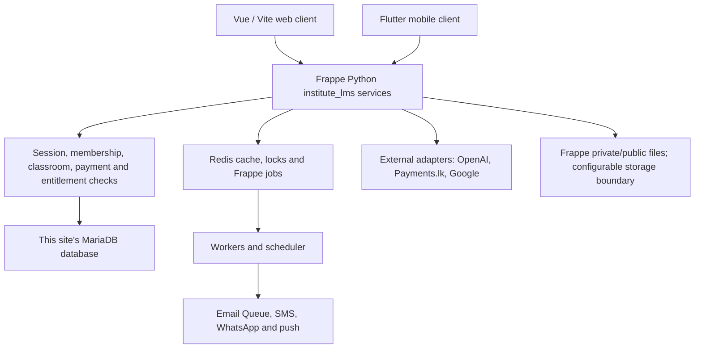
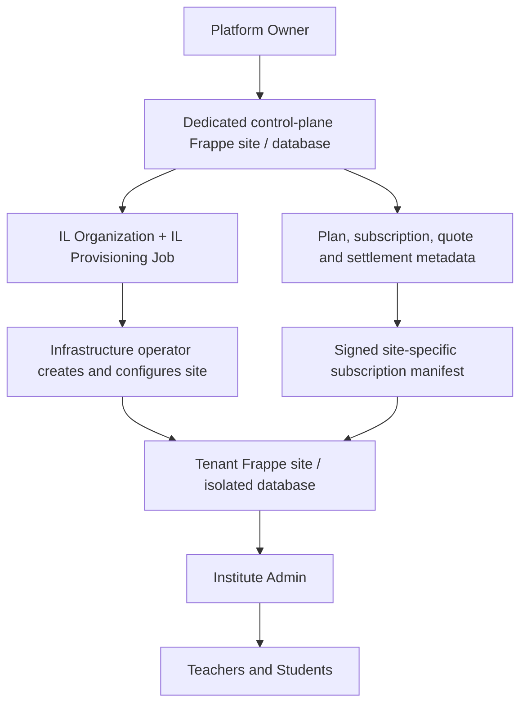

# SISU final system flow

Source-verified walkthrough · 2 October 2026 · RUN 3 release candidate plus isolated preview.

## Read this first

SISU is one learning product with a Vue web client and a Flutter client integration boundary. An organization has its own Frappe site and database. Students learn within authorized classrooms; teachers manage assigned teaching work; Institute Admins operate their local institute; Platform Owners manage organization metadata and commercial policy on a separate control-plane site.

**IMPLEMENTED means present in source, not accepted on live infrastructure.** This review did not run Frappe, MariaDB, Redis or live payment/AI/messaging providers. The local preview uses fictional data, and its role selector is not authentication. See [final status](FINAL_SYSTEM_STATUS.md) for actual tests and acceptance boundaries.

The authoritative archive is `SISU_FINAL_RELEASE_CANDIDATE.zip`, SHA-256 `21b88d9dd0d1acbbd12acfcd0b12a19fd30c1d3179ec75a442941941464fb67b`. Backend Python, schema, production Vue components, normal entry point and authorization were preserved for this task. Source paths below are relative to the release root. Method shorthand `ai.summary` means `/api/method/institute_lms.ai.summary`; it is not a newly invented REST route.

## The product in one picture

MariaDB and Redis are parallel services, not a pipeline in which every database query flows through Redis. Provider configuration is server-side. Private file reads and AI retrieval repeat application authorization; knowledge IDs and file URLs are not access credentials.

## Organization architecture

`platform.py` records organizations, provisioning progress and audited policy changes. `provisioning.py` and `scripts/` provide operator contracts. Creating a registry record does not create a server or DNS record. A control-plane owner cannot run cross-tenant academic SQL through this architecture. `saas.py` verifies HMAC manifests, tenant ID, hostname, revision and a short lease. Timely operator/automation delivery remains required; metadata changes do not instantly propagate by magic.

On each tenant, `api.institute()` requires one `IL Institute`. The institute code identifies an organization; it is never a password. Dedicated databases isolate tenant records. DNS/canonical-host mapping, TLS, backups and correct per-site secrets remain deployment responsibilities.

## A normal learning day

1. The user opens the canonical tenant host. `native/PortalRoot.vue` requests `portal_session.current`, receives identity/CSRF information and resolves the subscription. Students retain the Google sign-in requirement.
2. `App.vue` displays role-appropriate navigation. Every real API repeats authorization; changing a route cannot grant access.
3. A student opens a classroom. Membership, enrollment, lifecycle and class billing determine access. Institute school-mode exemption does not erase independent teacher fees.
4. Authorized material is returned by `materials.content`, or a mapped native LMS lesson is checked by `native_access.py`. A private file cannot safely be opened merely by guessing its URL.
5. Papers support quiz/written/upload workflows. Attempts and teacher marking provide actual results. This is not a claim that every older dashboard progress graphic represents measured academic progress.
6. Events create channel deliveries. In-app messages can be read immediately; email and messaging delivery require configured queues/providers and consent.
7. Eligible users open Premium AI. The backend resolves feature flags, allowance, course access and source versions before provider work. Citations point to authorized source records. Teachers review generated drafts before official publication or grading.
8. Browser logout ends the Frappe session. Mobile logout revokes the owned SISU token record. Neither client owns the final authorization decision.

## What exists in the code

| Area | Main source | Meaning and boundary |
|---|---|---|
| Portal, roles and navigation | `frontend/src/native/PortalRoot.vue`, `App.vue`, `api.py`, `portal_policy.py` | Real session bootstrap, Google student policy, scoped membership and role screens |
| Classes, sessions and materials | `api.py`, `teaching.py`, `catalog.py`, `materials.py`, `native_access.py` | SISU classrooms and mapped upstream LMS courses; enrollment/payment checks |
| Assessments | `papers.py`, `paper_rules.py`, `native/Papers.vue` | `IL Paper` and `IL Paper Attempt`; draft, publish, submit, mark; assignments use this paper workflow |
| Commercial policy | `platform.py`, `saas.py`, `saas_rules.py`, `usage.py` | Server-resolved plans, subscription states, custom overrides and limits |
| Two payment businesses | `payments.py`, `payments_lk.py`, `subscription_payments.py` | Student class invoice settlement versus organization subscription settlement |
| Notifications and OTP | `notification_service.py`, `notifications.py`, `otp.py`, `providers.py` | Outbox, preferences, verification and neutral SMS/push adapters |
| AI and knowledge | `ai.py`, `ai_provider.py`, `knowledge.py`, `ai_accounting.py` | Responses API generation, hosted retrieval, permission checks and credit audit |
| Storage and retention | `storage.py`, `retention.py`, `ai_retention.py` | Quota hooks, protected reads, lifecycle and limited cleanup |
| Operations | `health.py`, `hooks.py`, deployment docs and workflow files | Readiness probes and release instructions; not evidence of deployment |

## Scope limits and documentation corrections

- RUN 1/2/3 are implementation labels, not proof that a live service passed acceptance.
- STARTER, PREMIUM AI and CUSTOM are seeded; prices and capacity limits start at zero. Zero is unconfigured/denied, not a promised free or unlimited plan. Historical preview prices belong to fictional fixtures and must not be sold as current rates.
- Control-plane analytics are registry/subscription metadata. Tenant academic aggregates are local and role-restricted; there is no platform-wide private student analytics database.
- AI uses OpenAI hosted vector stores with local knowledge metadata. There is no pgvector migration, self-hosted vector engine or production-scale Python vector scan.
- AI credits are configurable request units. Token usage and optional rate-based cost estimates are separate measurements.
- `certificate.issued` event support and upstream LMS certificate hooks do not establish a new full custom certificate designer or standalone results warehouse.
- `IL Paper`/`IL Paper Attempt` implement assignment-style submissions and feedback; there is no separate custom `IL Assignment` model.
- The default storage implementation is Frappe files. An adapter boundary is not evidence that S3 or a scalable video service has been deployed.
- The mobile parity work adds client screens/models/adapters; backend connection and device/provider acceptance remain pending where its handoff says so.

## Continue reading

[Role journeys](ROLE_USER_FLOWS.md) · [Feature/API matrix](FEATURE_TECHNICAL_FLOWS.md) · [AI detail](AI_SYSTEM_FLOW.md) · [Plans and payments](PLAN_SUBSCRIPTION_FLOW.md) · [Web/mobile](WEB_MOBILE_ARCHITECTURE.md) · [Preview guide](PREVIEW_GUIDE.md) · [Acceptance status](FINAL_SYSTEM_STATUS.md).

The source-derived API and schema appendix is in `SYSTEM_SOURCE_INDEX.md`; it includes actual method signatures and all custom DocType names. Existing `DEPLOYMENT_RUNBOOK.md`, `SITE_CONFIG_TEMPLATE.json`, `PROVIDER_ACCEPTANCE.md` and `MOBILE_API_HANDOFF.md` remain the operational handoff.

## Declared technology and runtime evidence

The inspected package declares Vue 3.5.27, Vite 6.4.3 and the existing Vue plugin 5.2.4; npm/package-lock drives the web build. The custom Python app is version 0.1.0, requires Python >=3.11 and uses Flit/Bench packaging. Its Bench metadata declares Frappe >=17.0.0-dev,<18.0.0 and LMS >=2.0.0-dev. These are compatibility ranges, not proven deployed versions or commit pins. MariaDB and Redis are architecture/runtime requirements; no live server version was read in this task. Requirements include requests, regex, Pillow, pypdf and defusedxml rather than a replacement AI framework. See pyproject.toml and frontend/package-lock.json for exact declared/locked dependency evidence.

CI is the existing `.github/workflows/release-checks.yml`; it prepares checks/build artifacts without automatic production deployment. Frappe schema evolution uses DocType JSON and post-model-sync patches; manual cross-tenant SQL migration is not introduced. Deployment, secrets, queue health, backups, domains/TLS and staging compatibility are covered by the existing operational documents and final status.
