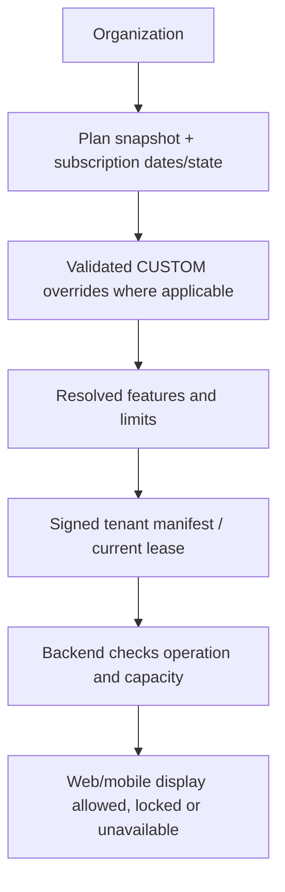

# Plans, subscriptions and the two payment flows

## Simple model

An organization purchases a configured plan. SISU resolves that subscription into feature booleans and numeric limits. Clients display the result; backend services enforce it. A student's class payment is a separate transaction owed to the class owner.



Source: `saas_rules.py`, `saas.py`, `platform.py`, `usage.py`, `subscription_payments.py`, `patches/run1.py`, `release.py`; UI: `native/Subscription.vue`, `ControlPlane.vue`.

## Definitions and pricing truth

| Plan | Seeded meaning | Configuration boundary |
|---|---|---|
| STARTER | Core LMS/integration/branding flags; AI flags disabled | Operator must configure real capacities and commercial price |
| PREMIUM AI | Core plus the twelve named AI feature flags | AI also needs provider settings, student safeguards and allowance |
| CUSTOM | Configurable base plus audited exact feature/limit/support overrides | Tenant-specific commercial contract; no implicit unlimited access |

The migration seeds zero limits and zero prices. `0` capacity denies allocation. A zero/unset commercial price is rejected for paid subscription checkout rather than treated as a free plan. No final selling price is established by this release. Preview numbers and older demo plan prices are fictional. Plan edits do not silently rewrite existing signed subscription snapshots or immutable checkout quotes.

Feature keys: `lms`, `integrations.email`, `integrations.sms`, `integrations.whatsapp`, `integrations.push`, `integrations.youtube`, `integrations.calendar`, `branding`, `custom_domain`, plus `ai.assistant`, `ai.rag`, `ai.summaries`, `ai.notes`, `ai.flashcards`, `ai.quiz`, `ai.questions`, `ai.assignments`, `ai.search`, `ai.recommendations`, `ai.teacher`, `ai.analytics`.

Limits: `students`, `teachers`, `storage_bytes`, `ai_credits`, `classes`, `courses`. There is no hardcoded unlimited AI. Features must be known boolean keys; limits are nonnegative integers. CUSTOM overrides merge validated feature/limit values and optional support tier; `platform.override` requires the eligible plan and an audit reason. Capacity enforcement and resource-specific checks happen server-side, including row-locked subscription accounting where required.

## State resolution

| State | Operational meaning in resolver |
|---|---|
| `trial` | Eligible timed trial; available only within dates and valid enabled tenant lease |
| `active` | Current period available subject to normal feature/limit checks |
| `grace` | Temporary available window until explicit grace deadline |
| `past_due` | Unavailable; not silently converted into grace |
| `suspended` | Unavailable until authorized eligible recovery |
| `cancelled` | Unavailable; remains explicit |
| `expired` | Unavailable, including missing end date or elapsed allowed period |

`effective_state` computes expiry/grace for active/trial subscriptions. The last four explicit states remain sticky. `saas.resolved` additionally checks starts-at, tenant enabled and lease freshness. Recovery/auth/billing paths have narrowly scoped exemptions so users can recover access; that is not blanket LMS access.

Trials are one-time audited grants of 1–30 days for eligible organizations with no prior paid settlement. Grace requires appropriate previous settled subscription conditions and a bounded deadline (up to 14 days in the administrative operation). Reactivation validates existing paid eligibility; it is not a generic free activation switch. State changes, overrides and suspension need a newly delivered tenant manifest.

## Control-plane-to-tenant policy

`IL Organization`, `IL Provisioning Job`, `IL SaaS Plan`, `IL Subscription`, `IL Trial Claim` and `IL SaaS Audit` live where their workflow belongs. The control plane issues a canonical HMAC-signed policy using the tenant's configured key. Tenant `saas.apply_manifest` checks signature, matching tenant and hostname, increasing revision, issue time within five minutes and lease no longer than 24 hours. The receiving site stores authoritative local policy. A valid institute code is not enough to call it successfully.

The release provides interfaces and provisioning scripts. Infrastructure site creation, DNS/TLS and recurring manifest delivery must be operated/automated during deployment. A stale lease can deliberately deny access; monitor it before onboarding real customers.

## Organization → SISU subscription payment

```mermaid
sequenceDiagram
  participant U as Authorized billing contact
  participant C as Control-plane backend
  participant P as Payments.lk
  participant T as Tenant backend
  U->>C: subscription_payments.quote(tenant, plan)
  C->>C: Validate contract; immutable 15-minute quote
  U->>C: subscription_payments.checkout(quote)
  C->>P: Hosted checkout; idempotent payment attempt
  P-->>U: Hosted return or cancel
  U->>C: Read status (does not activate)
  P->>C: Signed raw-body webhook
  C->>C: HMAC, identity, amount, currency, mode; row locks
  C->>C: Ledger + verified transaction + subscription snapshot
  C->>T: Operator delivers newly signed manifest
  T->>T: Verify site binding and apply policy
```

`IL Checkout Quote` preserves quoted amount/currency/plan features/limits/version. `IL Payment Attempt` models checkout state; `IL Webhook Event` deduplicates callback bodies; `IL Payment Transaction` records verified settlement. `created/pending/succeeded/failed/cancelled` reflect attempt state; duplicate/reordered callbacks cannot downgrade succeeded to failed. Paid renewal uses verified settlement and the saved quote, not current UI values. CUSTOM requires exactly one appropriate active platform/tenant price assignment in `IL Price Assignment`; configured Monthly/Yearly contracts are validated. Inspect `subscription_payments.py` for period computation (30/366-day contract periods), rather than assuming calendar-month proration or refunds.

The subscription merchant uses `il_subscription_payments_lk_*` settings, separately from student/class merchant settings. Billing contact authorization is bound to the organization on the control plane. A frontend return URL or `paid` label never activates entitlement. A paid control-plane subscription still requires manifest delivery to update a tenant.

## Student → class owner payment

`ClassFees.vue`/existing payment UI → `payments.checkout(invoice, customer)` → `payments_lk.checkout` → hosted provider. The public callback is `payments_lk.notify`. It verifies raw-body HMAC, mode, invoice/reference, checkout identity, amount/currency and payment ID before changing `IL Invoice` to Paid. Invoice locking and duplicate payment-reference checks protect settlement. Receipt and wallet earning/event follow the trusted state change.

`class_billing.py` decides class owner, bill target and school exemption. Only intended institute-owned classes get school-mode exemption; independent teacher paid classes remain billable. Free classes and authorized teacher/admin teaching access retain existing semantics. `wallet.py` resolves independent teacher versus institute wallet consistently. The legacy PayHere branch in `payments.py` remains selectable by configuration; it is not the default Payments.lk subscription flow. No new automatic refund engine is claimed.

## Usage and storage

`usage.py` and subscription locks protect resource allocations; `IL Usage Entry` supplies usage accounting. `storage.py` checks quota before file bytes are accepted and records `IL Stored Object` metadata. AI uses monthly `ai_credits` reservations plus `IL AI Usage` for requests, tokens and optional cost estimates. Current limits/remaining values are server data, not client-side pricing calculations. Calendar-month AI bucket/reset differs from subscription renewal dates; do not display them as identical.

## Operational failures

Missing positive price/contract → checkout unavailable. Invalid webhook → no settlement. Provider timeout → pending/review/retry rules, never optimistic paid access. Exhausted quota → operation rejected. Expired manifest → tenant access unavailable despite a registry label. Every case needs staging tests with real callbacks, concurrent requests and clock boundaries before commercial acceptance.
