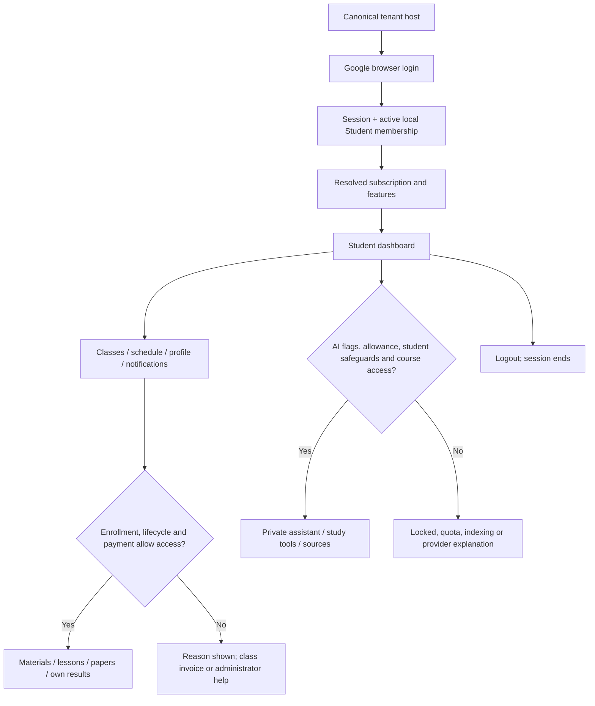
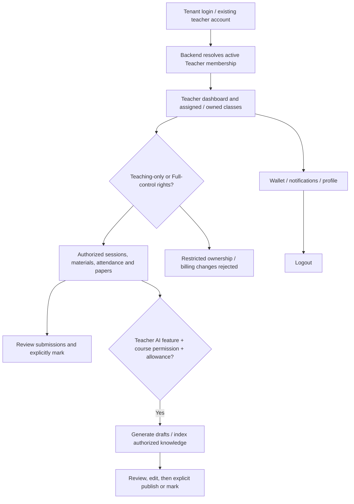
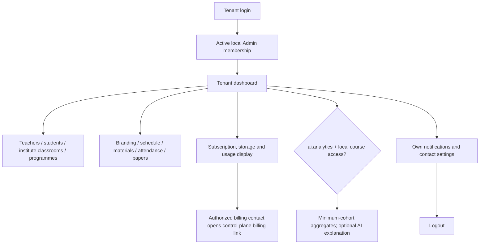
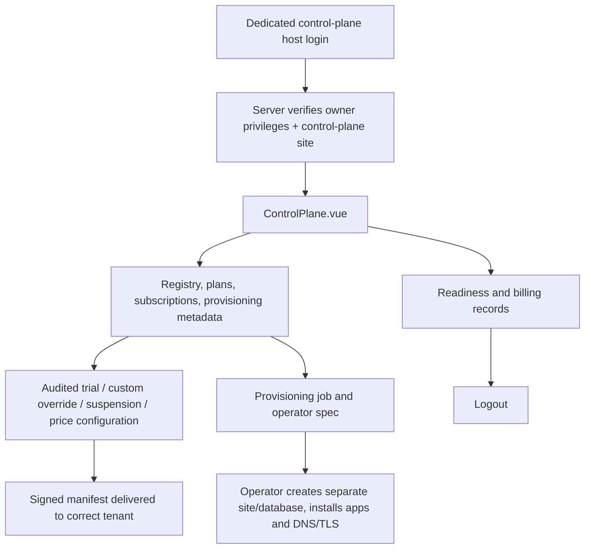

# SISU role journeys

The browser is a display client. Backend membership, object ownership, lifecycle, billing and entitlement checks remain authoritative. A preview role selection changes fictional UI fixtures only.

## Student

**Entry and account.** `PortalRoot.vue`, `portal_session.current` and `portal_policy.py` retain Google-based student access. A Frappe login alone does not override the student policy. A signed-in user without an active local membership can see onboarding/profile/verification rather than an invented classroom entitlement. Private contact details live separately from public profile data; student birthday/guardian rules are enforced by private-contact services.

**Daily navigation.** `App.vue` exposes the existing dashboard, classrooms, schedule, programmes, papers, profile/connections, operations, news, class fees, Study Room and settings, plus AI, organization plan/usage and notifications. Visibility depends on current role and feature data. Open a classroom to see authorized sessions/materials/announcements; assessments show the user's own attempts and released results. Study Room utilities are distinct from authoritative academic progress.

**Payment.** Students initiate checkout for their own `IL Invoice` through `payments.checkout`; they do not purchase a tenant subscription simply by being a student. The hosted return is pending until verified backend settlement. Independent teacher paid classes remain payable in school mode. A free class or valid paid enrollment follows existing access rules.

**AI.** The assistant, course Q&A, summary, notes, cards, practice questions, search and recommendations depend on resolved `ai.*` flags, source access and quota. Student safeguards and hosted-retrieval review are additional conditions. A student cannot read another student's conversation, upload arbitrary knowledge into another class, use teacher grading tools or browse another tenant.

**Notifications/profile/logout.** Inbox read state and preferences are user-scoped. SMS/WhatsApp verification returns cooldown/expiry/provider errors honestly. Email/WhatsApp consent does not imply provider delivery. Browser logout uses Frappe logout; a mobile client must revoke its own SISU session separately.

**Common failures.** Google login unavailable, no active membership, expired subscription/manifest, unpaid or expired class, exhausted credits, stale/unindexed source, provider unavailable, unsupported document, rejected verification, expired session. The UI should display the server message; a hidden navigation item is not a security boundary.

## Teacher

**Entry.** Existing Frappe/provider onboarding remains; teacher invitations and profile approval are separate from teaching authorization. `teaching.py` and `teaching_rules.py` resolve ownership/assignment. Accepting an invitation can create a membership request; it is not unrestricted access.

**Work.** The teacher sees the existing provider/dashboard and classroom workspace, schedule, papers, programmes, attendance/support, materials, announcements, profile, notifications and authorized wallet/payout tools. Teaching-only versus Full-control rights remain meaningful; being listed as a teacher does not authorize every class or billing operation.

**Assessment and AI.** `Papers.vue` connects draft/publish/attempt/mark APIs. AI generated questions/quiz content must be reviewed before publication. Assignment assistance takes an authorized paper attempt, returns a draft and never writes its grade. `AIWorkspace.vue` adds lesson plans, explanation/examples, revision, quiz drafts and knowledge ingestion to the shared study tools. Unsupported DOC/PPT or scanned material cannot be labelled Ready without extracted text.

**Money.** Independent teacher classes resolve the teacher wallet; institute-owned classes resolve the institute wallet. Payout eligibility and method review are backend-controlled. Viewing a wallet does not grant platform plan administration.

**Cannot see.** Other teachers' unassigned private classes, unrelated submissions, students' private conversations, other tenant data, platform merchant secrets or control-plane powers. Owner-only provider configuration is not automatically teacher configuration.

**Failures/logout.** Missing assignment, inactive membership, Teaching-only restriction, class expiry, upload quota, unpaid student access, provider/AI quota error and unsupported source have explicit denial paths. Existing browser logout and mobile revocation semantics apply.

## Institute Admin

**Scope.** In this product the member role is `Admin`; that is Institute Admin, not Platform Owner. The tenant bootstrap selects the local institute. Admin classroom listing is scoped to institute-owned classes; other class relationships remain subject to the actual room/teaching service checks. It is not a license to inspect every independent teacher's operation.

**Operations.** Tenant users, teaching membership requests, institute classes/programmes, sessions/materials, assessments, attendance, announcements, local branding and operational billing use existing admin APIs. `Subscription.vue` displays server policy and storage usage; quotas cannot be raised in Vue. Plan changes and paid renewal use a designated control-plane billing contact, not cross-site database writes from the tenant.

**AI insights.** Local aggregated assessment/attendance/AI usage is available only when entitled. Small cohorts are suppressed. Optional AI explanation receives verified aggregates. Private student conversations are not an admin browsing feature.

**Cannot see.** Another site's users/files, platform secrets, Bench controls, platform organization registry or private student conversations. Local administrator status does not imply `platform.owner` authority; actual platform functions use control-plane/owner checks.

**Errors and logout.** Subscription suspension or stale manifest restricts normal LMS use while recovery/billing flows remain. Quota, course ownership, verification and provider failures require administrator/operator action. Logout ends only the current browser session; other owned mobile sessions have explicit revocation.

## Super Admin / Platform Owner

**Entry and navigation.** `PortalRoot.vue` routes a qualified owner on `il_control_plane` to `native/ControlPlane.vue`: Organizations, Plans, Provisioning, Billing and Readiness. A billing contact may access a restricted billing view without acquiring owner powers. The older `SuperAdmin.vue` provider/profile review console remains a separate existing screen; the preview labels it legacy to avoid confusing it with the new control plane.

**Actions.** Register organizations and jobs; inspect hostname/code/domain/contact metadata; edit plan features/limits and configured prices; assign audited CUSTOM overrides/contracts; grant eligible one-time trials; suspend/reactivate eligible subscriptions and record provisioning progress. Registry counts describe records on the control plane. Provisioning buttons record a result rather than running arbitrary server commands.

**No hidden access.** `ai_access.authorize` explicitly rejects learning content requests on the control plane and requires a real active local member on a tenant. Platform owner status is not a private student chat or RAG bypass. There are trusted site-operator/System Manager facilities elsewhere in Frappe; do not give those credentials to tenant users or describe their convenience paths as ordinary Institute Admin access.

**Payments and failures.** Paid activation comes from verified subscription settlement; an owner cannot turn an unverified payment redirect into a paid plan. Invalid contracts, stale manifests, duplicate hostname/code, ineligible trial/reactivation, unknown features or limits, insufficient audit reason and unavailable providers fail. An operator must deliver renewed policy and provision infrastructure. Browser logout uses the same Frappe session mechanism.

## Shared permission checklist behind every diagram

`Session → active local membership → object/class relationship → lifecycle/payment access → feature entitlement → quota → operation-specific validation`. Not every endpoint needs every step, but the endpoint's actual server checks are binding. Preview navigation deliberately does not exercise these production checks; tests and staging acceptance must do that separately.
