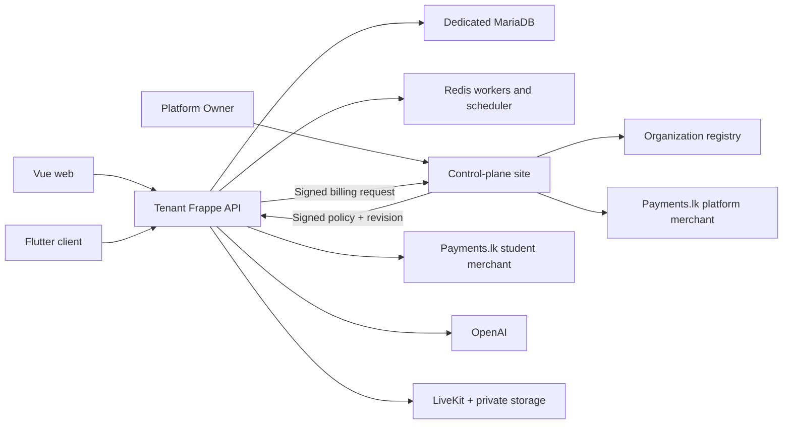

# SISU final candidate: setup and handover

V2 is an implementation candidate with isolated previews. **It is not production-accepted.** SISU_FINAL_VERIFICATION_AND_COMPLETION_REPORT.md and SISU_FINAL_COMPLETION_MATRIX.md are authoritative for current results and remaining integration/platform gaps. Earlier reports are historical.

## Architecture and boundaries

One organization = one Frappe site = one MariaDB database. All tenants use the same institute_lms, LMS and Frappe code. Platform operations run on a separate control-plane site. There is no cross-tenant SQL or shared knowledge index.

## Product policy

Customer offerings are free STARTER and monthly PREMIUM AI. Historical CUSTOM contracts and overrides are retained internally. `full_rules.final_policy` resolves expired Premium to Starter while `enabled` and signed-policy lease separately control organization access. An expired policy lease fails closed until refreshed; it is not a paid-plan expiry. A failed payment attempt does not modify the currently valid subscription period.

The migration fills the old all-zero Starter seed with configurable operational limits (100 students, 10 teachers, 1 GiB storage, 50 classes/courses, zero AI credits). These are deployment defaults, **not approved commercial pricing or promises**. Configure `il_starter_limits` before migration or edit the authoritative Starter definition. Existing configured positive limits are preserved. Fresh base-policy fields are copied to tenant manifests.

Owner `premium.configure_offer` versions a per-organization monthly price assignment. Tenant Admin calls the signed `billing_bridge`; quotes freeze amounts and entitlement snapshots. Existing Payments.lk HMAC/identity/amount/currency validation and row locking settle payment. `IL Premium Receipt` is created once; calendar-month renewal extends from the current paid end when applicable. Redirects do not activate plans. Owner configuration cannot be used by an Institute Admin.

`IL Policy Delivery` sends signed manifests to explicitly allowlisted HTTPS tenant hosts, records revision acknowledgements, retries failures and refreshes leases. Configure the matching per-tenant keys on both sides. A financial operation and policy transport are separate: a payment may be settled while delivery remains pending. UI refresh reads authority again; no login restart is required.

AI allowance is enforced before provider work. Individual mode requires an allocation and enforces it plus the organization monthly pool. Shared mode ignores individual caps but keeps stored allocations/history; the organization cap still applies. Credits are configured request units, not money. Existing usage records contain real provider token/cost metadata when available. Ambiguous outcomes keep reservations for reconciliation rather than blindly retrying.

## Staging first

1. Provision Linux, supported Python, MariaDB, Redis, Frappe Bench, workers/scheduler and HTTPS reverse proxy. Determine compatible Frappe 17/LMS revisions in staging and record exact tested commit pins; no unverified pins are invented here.
2. Back up each database and public/private files, encryption keys and private provider configuration before changes. Store backups separately and prove a restore.
3. Install the app and optional live/media Python extras in the Bench environment using your controlled dependency workflow. `livekit-api` and `boto3` remain optional until those providers are configured. Build Vue with the lockfile, `npm ci`, `npm test`, `npm run build`.
4. Run the existing schema migration sequence per staging site with `bench --site <site> migrate`; `institute_lms.patches.final_build` supplies policy defaults and `institute_lms.patches.release_v2` adds V2 indexes after schema synchronization. New DocTypes are synchronized by Frappe; no manual SQL table creation is required. Fresh install invokes the same initializer.
5. Create/configure the dedicated control-plane site and Platform Owner access; register organization hostname and billing contact through existing platform APIs/UI. Infrastructure/operator provisioning still creates the site/database, installs apps and initializes the tenant. Do not fake a completed provisioning job before the real step succeeds.
6. Configure tenant ID, canonical hostname, signing key, control-plane origin and allowed tenant delivery hosts. Use existing provisioning contract/manifest workflow and confirm actual delivery acknowledgement before enabling customer traffic.
7. Configure providers from the credentials checklist. No keys belong in Vue, Flutter, checked-in JSON, screenshots or chat.
8. Execute the full acceptance checklist on two isolated tenants. Verify denied cross-tenant access, unpaid content, revoked sessions, signed payment callbacks, concurrent quotas, retention and provider failures.
9. Roll out one tenant at a time: backup → code/dependencies → migration → asset build → restart workers/web → health checks → role smoke tests → monitor. Do not run production from `preview-dist` or `preview-web`.

## Hosting and rollback

Use your chosen main domain and explicit/wildcard tenant DNS, HTTPS for every canonical host, correctly scoped reverse-proxy routing and custom-domain TLS only after authoritative entitlement and ownership checks. Do not route unknown hostnames to another tenant. Restrict admin and provider configuration access. Configure SPF/DKIM/DMARC for the selected outbound mail domain; real DNS changes were not made.

Stop rollout if migration, callback routing, schema version, worker processing or policy acknowledgement fails. Preserve evidence and take the site out of service. Database rollback is not a code checkout: restore a compatible database/files/encryption-key backup and matching code, reconcile provider transactions and queued jobs before reopening. Financial records and purchased media must not be indiscriminately purged.

## Media/live notes

Default existing files remain in Frappe. New private video uploads use S3-compatible presigned POSTs after serialized quota reservation. Confirmed metadata becomes Ready; incomplete/ambiguous uploads retain reservations for operator reconciliation. Configure a private bucket, enabled object versioning, restrictive CORS for tenant origins and an authenticated/signed playback adapter. No remote-media purge is silently performed. Purchased object references are protected from ordinary retention transitions.

LiveKit is the new embedded web meeting adapter. Participant JWTs cannot record/administer rooms. Only the authorized class teacher invokes server recording controls. Recording readiness requires a verified provider webhook; storage accounting records actual reported size, including overages. Teachers can turn Ready recordings into lecture drafts. Live egress and private playback must use compatible bucket/key configuration. V2 adds native Flutter RTC controls, teacher recording review/publication, provider reconciliation, and explicit safe orphan/failed-recording cleanup. Automatic deletion of confirmed or financially referenced media is intentionally excluded. Real device/provider acceptance is still required.

Health APIs and existing CI remain in the repository; passing local tests is not proof that database migrations, Redis or provider webhooks work on a real Bench.

## V2 operator additions

Install optional Python extras `.[live,media]` when enabling LiveKit/private S3. V2 schema adds IL Lecture Refund, IL Commerce Event, IL Subscription Notice, paper blueprint/batch metadata and recording publication/removal state. New hooks deliver minimized commerce events and signed notices; keep scheduler/workers running and monitor pending/review rows. Never re-run providers manually with a new key to clear an ambiguous original operation.

Refund integration uses `il_lecture_refund_adapter`, a server-only dotted callable accepting payment_id, amount_minor, currency, request_key. It must perform or refetch the same idempotent refund, verify the provider response, and return verified=true, status=succeeded, matching payment identity/amount/currency/request_key and a durable reference. Missing or uncertain execution must fail or return non-success; only confirmed results reach ledger settlement. This is not a browser endpoint or an operator checkbox. A concrete vendor implementation remains required.

For failed recording cleanup, private media endpoint/bucket/region must exactly match recording configuration. Version-list/delete permissions are required. Cleanup checks terminal egress state, holds and references, deletes only the exact object key's versions and confirms absence before releasing quota. Failed deletion keeps quota reserved. Complete this acceptance in an isolated test bucket first.

The setup order is backup/restore rehearsal → staging schema migration → assets/dependencies → worker/web restart → health → signed policy acknowledgement → commerce retry/replay → provider/device checks → approved tenant-by-tenant rollout. Preview assets are excluded from production serving paths. Native iOS setup and provider-specific SMS/push/refund adapters are explicit handoff work, not assumed configuration success.
