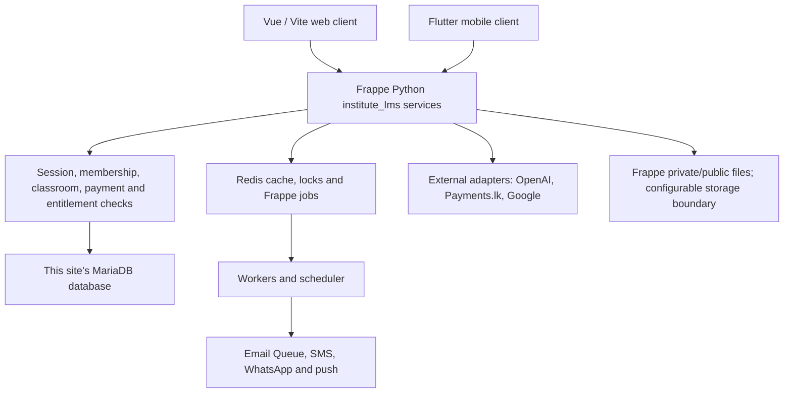
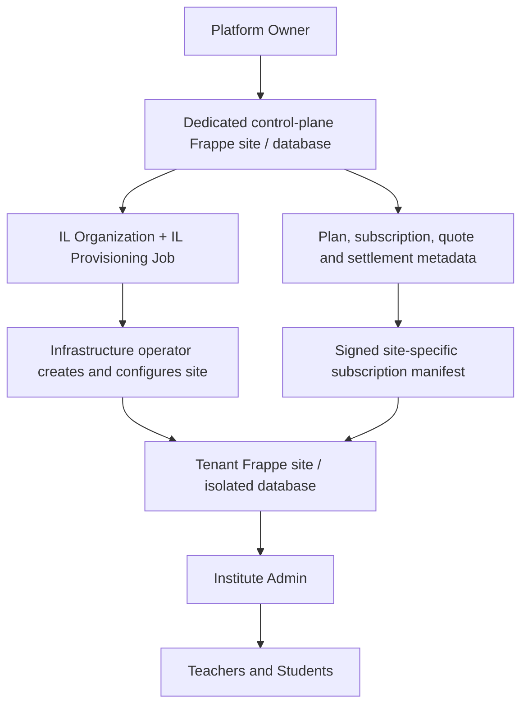
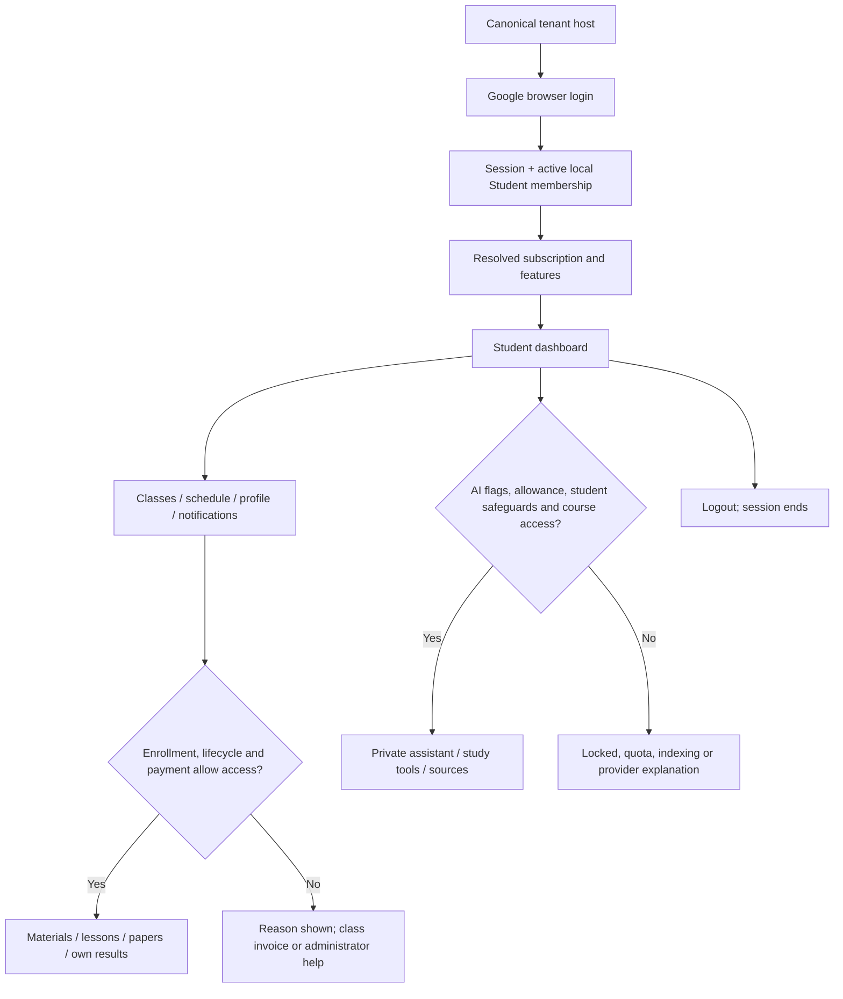
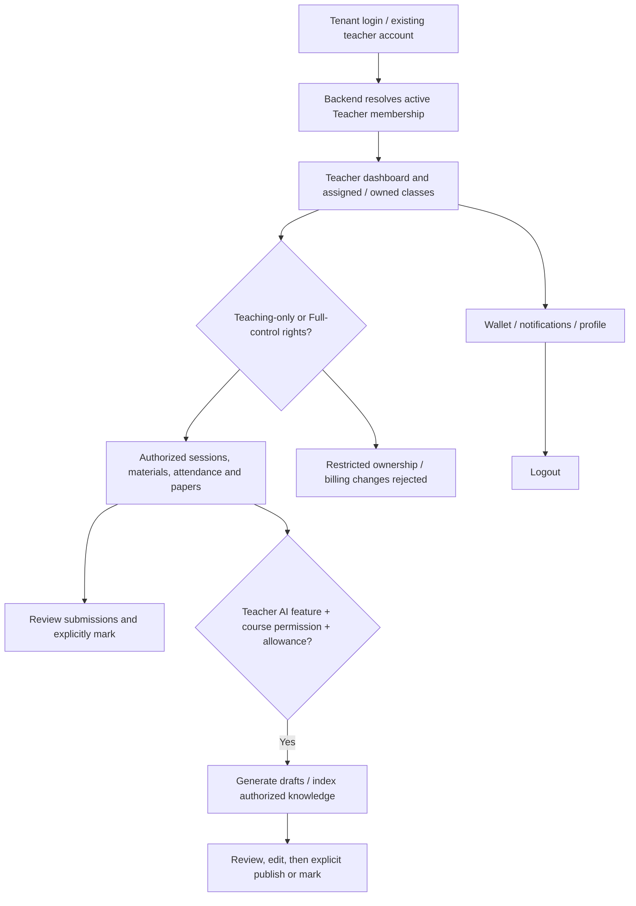
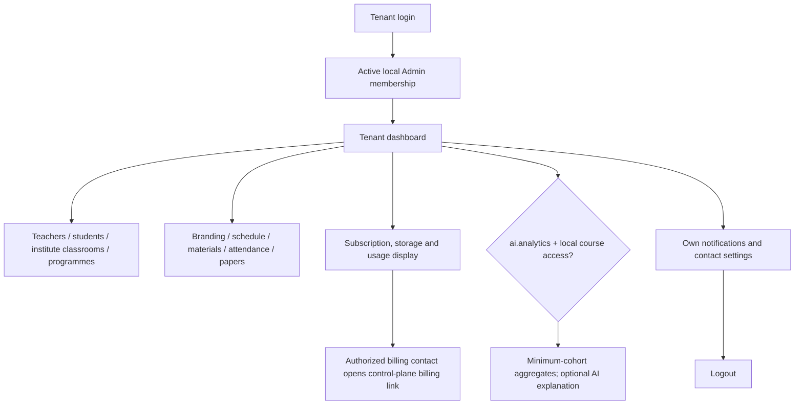
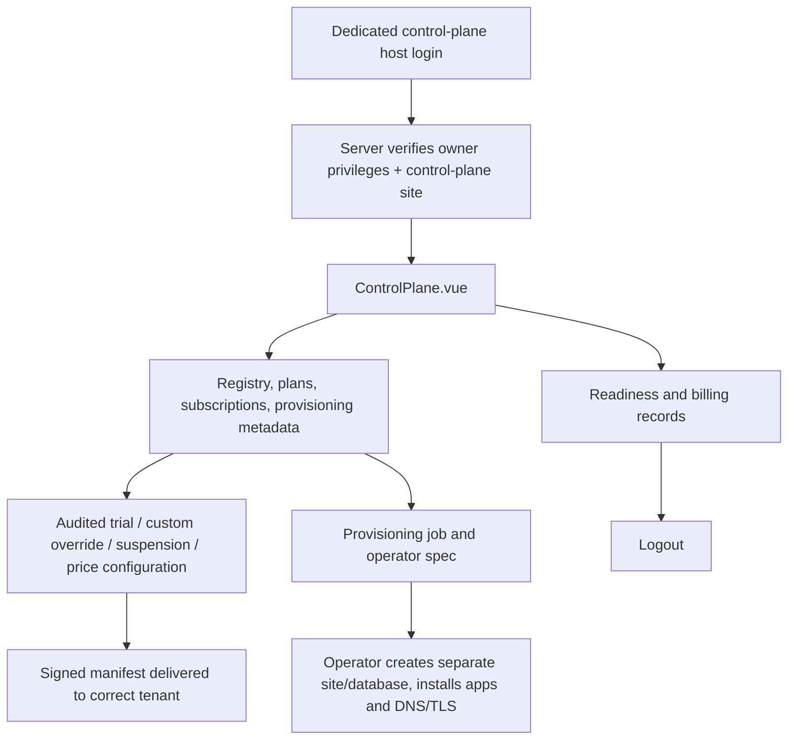
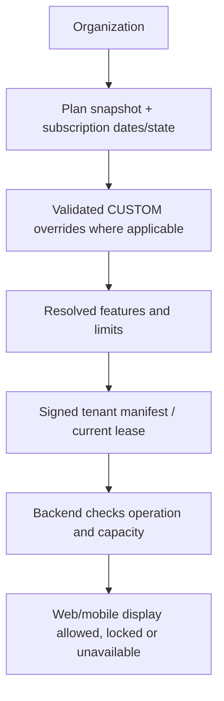
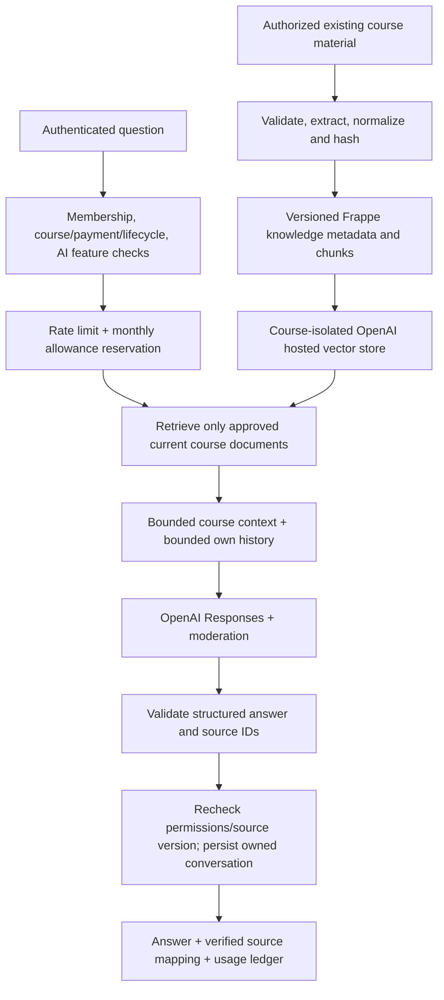
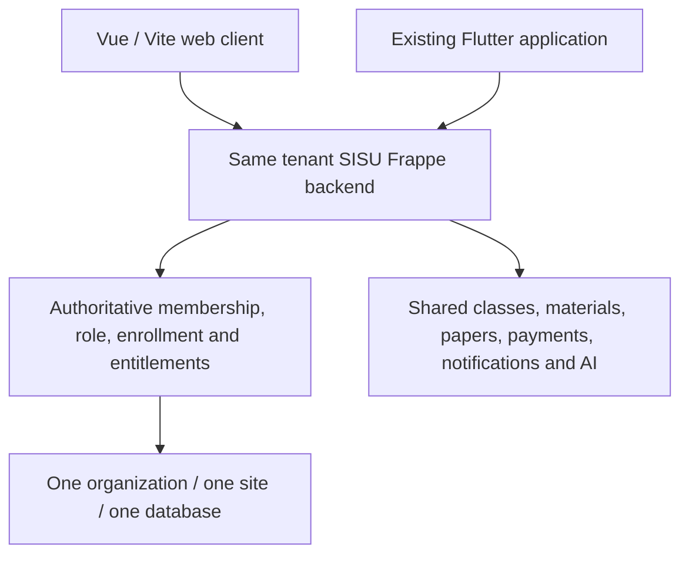

# SISU final system master document

Source-grounded management and engineering handoff · 2 October 2026

This combines the eight focused documents. Source code is authoritative; implemented code, configuration readiness, provider acceptance and mobile connection are separate states. The included interactive preview is fictional and local-only.

## Table of contents

1. [System overview](#part-1) — [FINAL_SYSTEM_FLOW.md](FINAL_SYSTEM_FLOW.md)
2. [Role journeys](#part-2) — [ROLE_USER_FLOWS.md](ROLE_USER_FLOWS.md)
3. [Plans and subscription billing](#part-3) — [PLAN_SUBSCRIPTION_FLOW.md](PLAN_SUBSCRIPTION_FLOW.md)
4. [Feature technical flows](#part-4) — [FEATURE_TECHNICAL_FLOWS.md](FEATURE_TECHNICAL_FLOWS.md)
5. [AI architecture and features](#part-5) — [AI_SYSTEM_FLOW.md](AI_SYSTEM_FLOW.md)
6. [Web and mobile architecture](#part-6) — [WEB_MOBILE_ARCHITECTURE.md](WEB_MOBILE_ARCHITECTURE.md)
7. [Interactive preview guide](#part-7) — [PREVIEW_GUIDE.md](PREVIEW_GUIDE.md)
8. [System status and acceptance](#part-8) — [FINAL_SYSTEM_STATUS.md](FINAL_SYSTEM_STATUS.md)
9. [Source-derived API and DocType index](SYSTEM_SOURCE_INDEX.md)

---

<a id="part-1"></a>

<!-- Source: FINAL_SYSTEM_FLOW.md -->

## SISU final system flow

Source-verified walkthrough · 2 October 2026 · RUN 3 release candidate plus isolated preview.

### Read this first

SISU is one learning product with a Vue web client and a Flutter client integration boundary. An organization has its own Frappe site and database. Students learn within authorized classrooms; teachers manage assigned teaching work; Institute Admins operate their local institute; Platform Owners manage organization metadata and commercial policy on a separate control-plane site.

**IMPLEMENTED means present in source, not accepted on live infrastructure.** This review did not run Frappe, MariaDB, Redis or live payment/AI/messaging providers. The local preview uses fictional data, and its role selector is not authentication. See [final status](FINAL_SYSTEM_STATUS.md) for actual tests and acceptance boundaries.

The authoritative archive is `SISU_FINAL_RELEASE_CANDIDATE.zip`, SHA-256 `21b88d9dd0d1acbbd12acfcd0b12a19fd30c1d3179ec75a442941941464fb67b`. Backend Python, schema, production Vue components, normal entry point and authorization were preserved for this task. Source paths below are relative to the release root. Method shorthand `ai.summary` means `/api/method/institute_lms.ai.summary`; it is not a newly invented REST route.

### The product in one picture



MariaDB and Redis are parallel services, not a pipeline in which every database query flows through Redis. Provider configuration is server-side. Private file reads and AI retrieval repeat application authorization; knowledge IDs and file URLs are not access credentials.

### Organization architecture



`platform.py` records organizations, provisioning progress and audited policy changes. `provisioning.py` and `scripts/` provide operator contracts. Creating a registry record does not create a server or DNS record. A control-plane owner cannot run cross-tenant academic SQL through this architecture. `saas.py` verifies HMAC manifests, tenant ID, hostname, revision and a short lease. Timely operator/automation delivery remains required; metadata changes do not instantly propagate by magic.

On each tenant, `api.institute()` requires one `IL Institute`. The institute code identifies an organization; it is never a password. Dedicated databases isolate tenant records. DNS/canonical-host mapping, TLS, backups and correct per-site secrets remain deployment responsibilities.

### A normal learning day

1. The user opens the canonical tenant host. `native/PortalRoot.vue` requests `portal_session.current`, receives identity/CSRF information and resolves the subscription. Students retain the Google sign-in requirement.
2. `App.vue` displays role-appropriate navigation. Every real API repeats authorization; changing a route cannot grant access.
3. A student opens a classroom. Membership, enrollment, lifecycle and class billing determine access. Institute school-mode exemption does not erase independent teacher fees.
4. Authorized material is returned by `materials.content`, or a mapped native LMS lesson is checked by `native_access.py`. A private file cannot safely be opened merely by guessing its URL.
5. Papers support quiz/written/upload workflows. Attempts and teacher marking provide actual results. This is not a claim that every older dashboard progress graphic represents measured academic progress.
6. Events create channel deliveries. In-app messages can be read immediately; email and messaging delivery require configured queues/providers and consent.
7. Eligible users open Premium AI. The backend resolves feature flags, allowance, course access and source versions before provider work. Citations point to authorized source records. Teachers review generated drafts before official publication or grading.
8. Browser logout ends the Frappe session. Mobile logout revokes the owned SISU token record. Neither client owns the final authorization decision.

### What exists in the code

| Area | Main source | Meaning and boundary |
|---|---|---|
| Portal, roles and navigation | `frontend/src/native/PortalRoot.vue`, `App.vue`, `api.py`, `portal_policy.py` | Real session bootstrap, Google student policy, scoped membership and role screens |
| Classes, sessions and materials | `api.py`, `teaching.py`, `catalog.py`, `materials.py`, `native_access.py` | SISU classrooms and mapped upstream LMS courses; enrollment/payment checks |
| Assessments | `papers.py`, `paper_rules.py`, `native/Papers.vue` | `IL Paper` and `IL Paper Attempt`; draft, publish, submit, mark; assignments use this paper workflow |
| Commercial policy | `platform.py`, `saas.py`, `saas_rules.py`, `usage.py` | Server-resolved plans, subscription states, custom overrides and limits |
| Two payment businesses | `payments.py`, `payments_lk.py`, `subscription_payments.py` | Student class invoice settlement versus organization subscription settlement |
| Notifications and OTP | `notification_service.py`, `notifications.py`, `otp.py`, `providers.py` | Outbox, preferences, verification and neutral SMS/push adapters |
| AI and knowledge | `ai.py`, `ai_provider.py`, `knowledge.py`, `ai_accounting.py` | Responses API generation, hosted retrieval, permission checks and credit audit |
| Storage and retention | `storage.py`, `retention.py`, `ai_retention.py` | Quota hooks, protected reads, lifecycle and limited cleanup |
| Operations | `health.py`, `hooks.py`, deployment docs and workflow files | Readiness probes and release instructions; not evidence of deployment |

### Scope limits and documentation corrections

- RUN 1/2/3 are implementation labels, not proof that a live service passed acceptance.
- STARTER, PREMIUM AI and CUSTOM are seeded; prices and capacity limits start at zero. Zero is unconfigured/denied, not a promised free or unlimited plan. Historical preview prices belong to fictional fixtures and must not be sold as current rates.
- Control-plane analytics are registry/subscription metadata. Tenant academic aggregates are local and role-restricted; there is no platform-wide private student analytics database.
- AI uses OpenAI hosted vector stores with local knowledge metadata. There is no pgvector migration, self-hosted vector engine or production-scale Python vector scan.
- AI credits are configurable request units. Token usage and optional rate-based cost estimates are separate measurements.
- `certificate.issued` event support and upstream LMS certificate hooks do not establish a new full custom certificate designer or standalone results warehouse.
- `IL Paper`/`IL Paper Attempt` implement assignment-style submissions and feedback; there is no separate custom `IL Assignment` model.
- The default storage implementation is Frappe files. An adapter boundary is not evidence that S3 or a scalable video service has been deployed.
- The mobile parity work adds client screens/models/adapters; backend connection and device/provider acceptance remain pending where its handoff says so.

### Continue reading

[Role journeys](ROLE_USER_FLOWS.md) · [Feature/API matrix](FEATURE_TECHNICAL_FLOWS.md) · [AI detail](AI_SYSTEM_FLOW.md) · [Plans and payments](PLAN_SUBSCRIPTION_FLOW.md) · [Web/mobile](WEB_MOBILE_ARCHITECTURE.md) · [Preview guide](PREVIEW_GUIDE.md) · [Acceptance status](FINAL_SYSTEM_STATUS.md).

The source-derived API and schema appendix is in `SYSTEM_SOURCE_INDEX.md`; it includes actual method signatures and all custom DocType names. Existing `DEPLOYMENT_RUNBOOK.md`, `SITE_CONFIG_TEMPLATE.json`, `PROVIDER_ACCEPTANCE.md` and `MOBILE_API_HANDOFF.md` remain the operational handoff.


### Declared technology and runtime evidence

The inspected package declares Vue 3.5.27, Vite 6.4.3 and the existing Vue plugin 5.2.4; npm/package-lock drives the web build. The custom Python app is version 0.1.0, requires Python >=3.11 and uses Flit/Bench packaging. Its Bench metadata declares Frappe >=17.0.0-dev,<18.0.0 and LMS >=2.0.0-dev. These are compatibility ranges, not proven deployed versions or commit pins. MariaDB and Redis are architecture/runtime requirements; no live server version was read in this task. Requirements include requests, regex, Pillow, pypdf and defusedxml rather than a replacement AI framework. See pyproject.toml and frontend/package-lock.json for exact declared/locked dependency evidence.

CI is the existing `.github/workflows/release-checks.yml`; it prepares checks/build artifacts without automatic production deployment. Frappe schema evolution uses DocType JSON and post-model-sync patches; manual cross-tenant SQL migration is not introduced. Deployment, secrets, queue health, backups, domains/TLS and staging compatibility are covered by the existing operational documents and final status.

---

<a id="part-2"></a>

<!-- Source: ROLE_USER_FLOWS.md -->

## SISU role journeys

The browser is a display client. Backend membership, object ownership, lifecycle, billing and entitlement checks remain authoritative. A preview role selection changes fictional UI fixtures only.

### Student



**Entry and account.** `PortalRoot.vue`, `portal_session.current` and `portal_policy.py` retain Google-based student access. A Frappe login alone does not override the student policy. A signed-in user without an active local membership can see onboarding/profile/verification rather than an invented classroom entitlement. Private contact details live separately from public profile data; student birthday/guardian rules are enforced by private-contact services.

**Daily navigation.** `App.vue` exposes the existing dashboard, classrooms, schedule, programmes, papers, profile/connections, operations, news, class fees, Study Room and settings, plus AI, organization plan/usage and notifications. Visibility depends on current role and feature data. Open a classroom to see authorized sessions/materials/announcements; assessments show the user's own attempts and released results. Study Room utilities are distinct from authoritative academic progress.

**Payment.** Students initiate checkout for their own `IL Invoice` through `payments.checkout`; they do not purchase a tenant subscription simply by being a student. The hosted return is pending until verified backend settlement. Independent teacher paid classes remain payable in school mode. A free class or valid paid enrollment follows existing access rules.

**AI.** The assistant, course Q&A, summary, notes, cards, practice questions, search and recommendations depend on resolved `ai.*` flags, source access and quota. Student safeguards and hosted-retrieval review are additional conditions. A student cannot read another student's conversation, upload arbitrary knowledge into another class, use teacher grading tools or browse another tenant.

**Notifications/profile/logout.** Inbox read state and preferences are user-scoped. SMS/WhatsApp verification returns cooldown/expiry/provider errors honestly. Email/WhatsApp consent does not imply provider delivery. Browser logout uses Frappe logout; a mobile client must revoke its own SISU session separately.

**Common failures.** Google login unavailable, no active membership, expired subscription/manifest, unpaid or expired class, exhausted credits, stale/unindexed source, provider unavailable, unsupported document, rejected verification, expired session. The UI should display the server message; a hidden navigation item is not a security boundary.

### Teacher



**Entry.** Existing Frappe/provider onboarding remains; teacher invitations and profile approval are separate from teaching authorization. `teaching.py` and `teaching_rules.py` resolve ownership/assignment. Accepting an invitation can create a membership request; it is not unrestricted access.

**Work.** The teacher sees the existing provider/dashboard and classroom workspace, schedule, papers, programmes, attendance/support, materials, announcements, profile, notifications and authorized wallet/payout tools. Teaching-only versus Full-control rights remain meaningful; being listed as a teacher does not authorize every class or billing operation.

**Assessment and AI.** `Papers.vue` connects draft/publish/attempt/mark APIs. AI generated questions/quiz content must be reviewed before publication. Assignment assistance takes an authorized paper attempt, returns a draft and never writes its grade. `AIWorkspace.vue` adds lesson plans, explanation/examples, revision, quiz drafts and knowledge ingestion to the shared study tools. Unsupported DOC/PPT or scanned material cannot be labelled Ready without extracted text.

**Money.** Independent teacher classes resolve the teacher wallet; institute-owned classes resolve the institute wallet. Payout eligibility and method review are backend-controlled. Viewing a wallet does not grant platform plan administration.

**Cannot see.** Other teachers' unassigned private classes, unrelated submissions, students' private conversations, other tenant data, platform merchant secrets or control-plane powers. Owner-only provider configuration is not automatically teacher configuration.

**Failures/logout.** Missing assignment, inactive membership, Teaching-only restriction, class expiry, upload quota, unpaid student access, provider/AI quota error and unsupported source have explicit denial paths. Existing browser logout and mobile revocation semantics apply.

### Institute Admin



**Scope.** In this product the member role is `Admin`; that is Institute Admin, not Platform Owner. The tenant bootstrap selects the local institute. Admin classroom listing is scoped to institute-owned classes; other class relationships remain subject to the actual room/teaching service checks. It is not a license to inspect every independent teacher's operation.

**Operations.** Tenant users, teaching membership requests, institute classes/programmes, sessions/materials, assessments, attendance, announcements, local branding and operational billing use existing admin APIs. `Subscription.vue` displays server policy and storage usage; quotas cannot be raised in Vue. Plan changes and paid renewal use a designated control-plane billing contact, not cross-site database writes from the tenant.

**AI insights.** Local aggregated assessment/attendance/AI usage is available only when entitled. Small cohorts are suppressed. Optional AI explanation receives verified aggregates. Private student conversations are not an admin browsing feature.

**Cannot see.** Another site's users/files, platform secrets, Bench controls, platform organization registry or private student conversations. Local administrator status does not imply `platform.owner` authority; actual platform functions use control-plane/owner checks.

**Errors and logout.** Subscription suspension or stale manifest restricts normal LMS use while recovery/billing flows remain. Quota, course ownership, verification and provider failures require administrator/operator action. Logout ends only the current browser session; other owned mobile sessions have explicit revocation.

### Super Admin / Platform Owner



**Entry and navigation.** `PortalRoot.vue` routes a qualified owner on `il_control_plane` to `native/ControlPlane.vue`: Organizations, Plans, Provisioning, Billing and Readiness. A billing contact may access a restricted billing view without acquiring owner powers. The older `SuperAdmin.vue` provider/profile review console remains a separate existing screen; the preview labels it legacy to avoid confusing it with the new control plane.

**Actions.** Register organizations and jobs; inspect hostname/code/domain/contact metadata; edit plan features/limits and configured prices; assign audited CUSTOM overrides/contracts; grant eligible one-time trials; suspend/reactivate eligible subscriptions and record provisioning progress. Registry counts describe records on the control plane. Provisioning buttons record a result rather than running arbitrary server commands.

**No hidden access.** `ai_access.authorize` explicitly rejects learning content requests on the control plane and requires a real active local member on a tenant. Platform owner status is not a private student chat or RAG bypass. There are trusted site-operator/System Manager facilities elsewhere in Frappe; do not give those credentials to tenant users or describe their convenience paths as ordinary Institute Admin access.

**Payments and failures.** Paid activation comes from verified subscription settlement; an owner cannot turn an unverified payment redirect into a paid plan. Invalid contracts, stale manifests, duplicate hostname/code, ineligible trial/reactivation, unknown features or limits, insufficient audit reason and unavailable providers fail. An operator must deliver renewed policy and provision infrastructure. Browser logout uses the same Frappe session mechanism.

### Shared permission checklist behind every diagram

`Session → active local membership → object/class relationship → lifecycle/payment access → feature entitlement → quota → operation-specific validation`. Not every endpoint needs every step, but the endpoint's actual server checks are binding. Preview navigation deliberately does not exercise these production checks; tests and staging acceptance must do that separately.

---

<a id="part-3"></a>

<!-- Source: PLAN_SUBSCRIPTION_FLOW.md -->

## Plans, subscriptions and the two payment flows

### Simple model

An organization purchases a configured plan. SISU resolves that subscription into feature booleans and numeric limits. Clients display the result; backend services enforce it. A student's class payment is a separate transaction owed to the class owner.



Source: `saas_rules.py`, `saas.py`, `platform.py`, `usage.py`, `subscription_payments.py`, `patches/run1.py`, `release.py`; UI: `native/Subscription.vue`, `ControlPlane.vue`.

### Definitions and pricing truth

| Plan | Seeded meaning | Configuration boundary |
|---|---|---|
| STARTER | Core LMS/integration/branding flags; AI flags disabled | Operator must configure real capacities and commercial price |
| PREMIUM AI | Core plus the twelve named AI feature flags | AI also needs provider settings, student safeguards and allowance |
| CUSTOM | Configurable base plus audited exact feature/limit/support overrides | Tenant-specific commercial contract; no implicit unlimited access |

The migration seeds zero limits and zero prices. `0` capacity denies allocation. A zero/unset commercial price is rejected for paid subscription checkout rather than treated as a free plan. No final selling price is established by this release. Preview numbers and older demo plan prices are fictional. Plan edits do not silently rewrite existing signed subscription snapshots or immutable checkout quotes.

Feature keys: `lms`, `integrations.email`, `integrations.sms`, `integrations.whatsapp`, `integrations.push`, `integrations.youtube`, `integrations.calendar`, `branding`, `custom_domain`, plus `ai.assistant`, `ai.rag`, `ai.summaries`, `ai.notes`, `ai.flashcards`, `ai.quiz`, `ai.questions`, `ai.assignments`, `ai.search`, `ai.recommendations`, `ai.teacher`, `ai.analytics`.

Limits: `students`, `teachers`, `storage_bytes`, `ai_credits`, `classes`, `courses`. There is no hardcoded unlimited AI. Features must be known boolean keys; limits are nonnegative integers. CUSTOM overrides merge validated feature/limit values and optional support tier; `platform.override` requires the eligible plan and an audit reason. Capacity enforcement and resource-specific checks happen server-side, including row-locked subscription accounting where required.

### State resolution

| State | Operational meaning in resolver |
|---|---|
| `trial` | Eligible timed trial; available only within dates and valid enabled tenant lease |
| `active` | Current period available subject to normal feature/limit checks |
| `grace` | Temporary available window until explicit grace deadline |
| `past_due` | Unavailable; not silently converted into grace |
| `suspended` | Unavailable until authorized eligible recovery |
| `cancelled` | Unavailable; remains explicit |
| `expired` | Unavailable, including missing end date or elapsed allowed period |

`effective_state` computes expiry/grace for active/trial subscriptions. The last four explicit states remain sticky. `saas.resolved` additionally checks starts-at, tenant enabled and lease freshness. Recovery/auth/billing paths have narrowly scoped exemptions so users can recover access; that is not blanket LMS access.

Trials are one-time audited grants of 1–30 days for eligible organizations with no prior paid settlement. Grace requires appropriate previous settled subscription conditions and a bounded deadline (up to 14 days in the administrative operation). Reactivation validates existing paid eligibility; it is not a generic free activation switch. State changes, overrides and suspension need a newly delivered tenant manifest.

### Control-plane-to-tenant policy

`IL Organization`, `IL Provisioning Job`, `IL SaaS Plan`, `IL Subscription`, `IL Trial Claim` and `IL SaaS Audit` live where their workflow belongs. The control plane issues a canonical HMAC-signed policy using the tenant's configured key. Tenant `saas.apply_manifest` checks signature, matching tenant and hostname, increasing revision, issue time within five minutes and lease no longer than 24 hours. The receiving site stores authoritative local policy. A valid institute code is not enough to call it successfully.

The release provides interfaces and provisioning scripts. Infrastructure site creation, DNS/TLS and recurring manifest delivery must be operated/automated during deployment. A stale lease can deliberately deny access; monitor it before onboarding real customers.

### Organization → SISU subscription payment

```mermaid
sequenceDiagram
  participant U as Authorized billing contact
  participant C as Control-plane backend
  participant P as Payments.lk
  participant T as Tenant backend
  U->>C: subscription_payments.quote(tenant, plan)
  C->>C: Validate contract; immutable 15-minute quote
  U->>C: subscription_payments.checkout(quote)
  C->>P: Hosted checkout; idempotent payment attempt
  P-->>U: Hosted return or cancel
  U->>C: Read status (does not activate)
  P->>C: Signed raw-body webhook
  C->>C: HMAC, identity, amount, currency, mode; row locks
  C->>C: Ledger + verified transaction + subscription snapshot
  C->>T: Operator delivers newly signed manifest
  T->>T: Verify site binding and apply policy
```

`IL Checkout Quote` preserves quoted amount/currency/plan features/limits/version. `IL Payment Attempt` models checkout state; `IL Webhook Event` deduplicates callback bodies; `IL Payment Transaction` records verified settlement. `created/pending/succeeded/failed/cancelled` reflect attempt state; duplicate/reordered callbacks cannot downgrade succeeded to failed. Paid renewal uses verified settlement and the saved quote, not current UI values. CUSTOM requires exactly one appropriate active platform/tenant price assignment in `IL Price Assignment`; configured Monthly/Yearly contracts are validated. Inspect `subscription_payments.py` for period computation (30/366-day contract periods), rather than assuming calendar-month proration or refunds.

The subscription merchant uses `il_subscription_payments_lk_*` settings, separately from student/class merchant settings. Billing contact authorization is bound to the organization on the control plane. A frontend return URL or `paid` label never activates entitlement. A paid control-plane subscription still requires manifest delivery to update a tenant.

### Student → class owner payment

`ClassFees.vue`/existing payment UI → `payments.checkout(invoice, customer)` → `payments_lk.checkout` → hosted provider. The public callback is `payments_lk.notify`. It verifies raw-body HMAC, mode, invoice/reference, checkout identity, amount/currency and payment ID before changing `IL Invoice` to Paid. Invoice locking and duplicate payment-reference checks protect settlement. Receipt and wallet earning/event follow the trusted state change.

`class_billing.py` decides class owner, bill target and school exemption. Only intended institute-owned classes get school-mode exemption; independent teacher paid classes remain billable. Free classes and authorized teacher/admin teaching access retain existing semantics. `wallet.py` resolves independent teacher versus institute wallet consistently. The legacy PayHere branch in `payments.py` remains selectable by configuration; it is not the default Payments.lk subscription flow. No new automatic refund engine is claimed.

### Usage and storage

`usage.py` and subscription locks protect resource allocations; `IL Usage Entry` supplies usage accounting. `storage.py` checks quota before file bytes are accepted and records `IL Stored Object` metadata. AI uses monthly `ai_credits` reservations plus `IL AI Usage` for requests, tokens and optional cost estimates. Current limits/remaining values are server data, not client-side pricing calculations. Calendar-month AI bucket/reset differs from subscription renewal dates; do not display them as identical.

### Operational failures

Missing positive price/contract → checkout unavailable. Invalid webhook → no settlement. Provider timeout → pending/review/retry rules, never optimistic paid access. Exhausted quota → operation rejected. Expired manifest → tenant access unavailable despite a registry label. Every case needs staging tests with real callbacks, concurrent requests and clock boundaries before commercial acceptance.

---

<a id="part-4"></a>

<!-- Source: FEATURE_TECHNICAL_FLOWS.md -->

## Feature-by-feature technical flows

### How to read the matrix

Each row follows **screen → service → permission/validation → stored data/provider → response**. Paths under `native/` mean `frontend/src/native/`; unprefixed Vue names are under `frontend/src/`. Python services are under `institute_lms/`. API shorthand maps to `/api/method/institute_lms.<module>.<method>` only where it is whitelisted; hooks/internal helpers are explicitly labelled. See [source index](SYSTEM_SOURCE_INDEX.md) for exact signatures and schema field lists.

Status codes in the table: **I = IMPLEMENTED in source**, **C = REQUIRES BACKEND CONFIGURATION**, **P = REQUIRES PROVIDER CREDENTIALS**, **S = REQUIRES STAGING ACCEPTANCE**, **W = WEB ONLY/web-first**, **M = MOBILE READY / MOBILE CONNECTION PENDING**. I does not mean a live deployment was tested. The Remaining Configuration column describes operational gaps; application validation failures are described below the table.

### Master flow table

| Feature | User Role | Frontend Screen | Backend Service/API | Plan/Entitlement | Database/DocType | External Provider | Input | Processing | Output | Permission Check | Current Status | Remaining Configuration |
|---|---|---|---|---|---|---|---|---|---|---|---|---|
| Browser login | All | native/PortalRoot.vue | portal_session.current; portal_policy.google_start; Frappe login | Recovery/session path | User; Social Login Key; IL Member | Google for student login | Canonical host, identity login | Authenticate; resolve member and CSRF | Session/role/bootstrap or onboarding | Google student policy; active site membership | I C P S M | Google client and callback, HTTPS, session acceptance |
| Role/dashboard | Student/Teacher/Admin | App.vue; StudentHome.vue; native/ProviderHome.vue | api.bootstrap; api.dashboard_summary; api.classrooms | lms | IL Institute; IL Member; IL Classroom; IL Enrollment | None | Authenticated session | One institute; role-scoped queries | Dashboard/class cards/access reasons | identity and room filters, not Vue route | I S M | Real role and dataset acceptance |
| Mobile sign-in | All eligible mobile users | Flutter system browser boundary | mobile_auth.authorize/approve/exchange | Auth recovery path | IL Mobile Session; User | Google browser login | PKCE challenge/state/verifier, redirect, device | CSRF approval; one-use code; hashed session token | Sisu token + expiry/site | Allowlisted HTTPS flow; student Google proof | I C P S M | Mobile redirect, PKCE client, secure storage/deep links |
| Logout/revoke | Own user | PortalRoot/App; mobile account UI | Frappe logout; mobile_auth.logout | Own auth recovery | Frappe session; IL Mobile Session | None | Current session or owned session ID | End browser session or revoke token | Logged out / revoked | Token/session owner; no mixed cookie and Sisu auth | I S M | Browser/device revocation tests |
| Provider registration | Prospective teacher/institute | native/RegistrationFlow.vue | registration.request_code/verify_code; review_application | Onboarding path | IL Registration Request; IL Public Profile | Frappe email | Application/email and verification code | Validation, rate limit, review workflow | Pending/approved/rejected application | Owner review, verification and duplicate checks | I C P S W | SMTP and account approval operations |
| Profiles/contact | Own user | commerce/ProfileEditor.vue; ContactSettings.vue | profiles.me/save_profile/upload_image; private_contact.get_details/save_details | Membership; branding where applicable | IL Public Profile; IL Private Contact; File | None | Public profile/private contact/image | Validate ownership, birthday/guardian rules, files | Saved own profile and private details | Own user; private fields excluded from directory | I S M | Uploads and guardian-policy acceptance |
| Email verification | Own member | ContactSettings.vue | contact.status/request_verification/verify/preferences | integrations.email for delivery | IL Member; verification cache; Email Queue | SMTP | Email, code, opt-in | Digest, expiry/attempt/rate checks; queue email | Verified contact; separate consent | Own member and verified-address requirement | I C P S M | Outgoing Email Account and deliverability |
| SMS / WhatsApp OTP | Own user | native/MobileVerification.vue | mobile_verification.request_code/verify; private_contact.request_whatsapp_code; otp.py | integration channel and auth policy | IL Verified Phone; Redis challenge | Configured SMS adapter / Meta | Phone/channel/code/challenge | Locked issuance; digest; cooldown, expiry, attempts; consume | Sent challenge metadata or verified/error | Own identity, phone format, rate/one-use controls | I C P S M | SMS implementation; WhatsApp auth template/token |
| Account controls | Own user/authorized reviewer | AccountControls.vue | accounts.account_controls/account_action | Recovery/role checks | IL Account Request; User/member data | None | Requested account action | Validate permitted action and dependencies | Request/status; no assumed universal instant purge | Own account or authorized review | I S M | Retention and account lifecycle acceptance |
| Class list/detail | Student/Teacher/Admin | App.vue classroom views | api.classrooms/classroom_detail | lms | IL Classroom; IL Enrollment; IL Session | None | Classroom ID | Scoped queries and billing/access decision | Permitted class detail or denied reason | Membership, teacher rights, enrollment, lifecycle | I S M | Production data and paid/free boundary tests |
| Class create/edit | Teacher/Admin | App.vue; TeachingSpaces.vue | api.save_classroom; teaching.py rights | lms; classes/courses limits | IL Classroom; LMS Course mapping | None | Title, owner/teaching/config fields | Validate allowed scope, limits and mapped course | Saved classroom | Teaching-only/Full-control; owner/institute rules | I S W | Mapped upstream LMS runtime verification |
| Enrollment/access | Student/Admin/authorized teacher | App.vue; Discover.vue; native/Programmes.vue | api.enroll/enrollments/set_access; catalog.join_class | lms; student limits where allocated | IL Enrollment; IL Invoice; IL Classroom | None until checkout | Class/student/request | Create enrollment, billing schedule, explicit access | Enrollment and permitted/locked state | Room/member scope; paid enrollment checks | I S M | Concurrent enrollment and billing acceptance |
| School mode billing | Student/content readers | Classroom access state | class_billing.school_exempt; api.create_enrollment (internal); api.access | lms | IL Institute; IL Classroom; IL Enrollment; IL Invoice | None | Owner type, school mode, debt | Exemption only institute-owned; paid teacher obligations retained | Free/exempt or payment-required access | Existing owner and billing logic | I S M | Regression on real migrated enrollments |
| Native LMS boundary | Authorized learner/staff | Native LMS links / existing lesson views | native_access.py hooks; mobile_api.lesson | lms plus class access | LMS Course; Course Lesson; File; SISU enrollment | Frappe LMS | Mapped course/lesson/file ID | Resolve SISU class; fail closed on unapproved native paths | Authorized native content | Payment/enrollment/private-file mapping | I S M | Exact pinned LMS route/hook integration tests |
| Programmes/modules | Teacher/Admin/Student | native/Programmes.vue | teaching.programmes/save_programme/enroll_programme/month_invoice | lms | IL Programme; IL Programme Module; IL Programme Enrollment | None | Programme/class module and enrollment | Validate ownership and programme billing anchor | Programme/detail/month invoice | Teaching rights and active authorized enrollment | I S M | Institutional billing data acceptance |
| Schedules/sessions | Student/Teacher/Admin | App.vue schedule/class view | api.schedule/save_session | lms | IL Session; IL Classroom | Optional Google services | Session date/time/class | Scope schedule; validate manager edits; queue events | Schedule/session plus notification work | Class membership/teaching rights | I S M | Timezone and concurrent editing acceptance |
| Attendance/support | Student/Teacher/Admin | native/Operations.vue | operations.mark_attendance/join_session/attendance/attendance_csv; tickets/thread/reply | lms | IL Attendance; IL Support Ticket; IL Support Reply | None | Session/student/status or support body | Check relationship, record attendance or scoped thread | Own/authorized roster, export or thread | Teacher assignment; own student support scope | I S M | Live attendance/join semantics and CSV review |
| Announcements/news | Authorized staff/readers | App.vue; commerce/FollowUpdates.vue | api.post_announcement/news/publish_news; profiles.publish_update/followed_updates | lms | IL Announcement; IL News; IL News Image; IL Provider Update | Notification adapters | Class/news body | Validate publisher; persist; emit scoped event | Announcement/news stream | Class rights; profile publisher/scope | I S M | Provider delivery and content policy |
| Material upload/read | Teacher/Admin upload; entitled readers | materials/MaterialViewer.vue; App.vue | materials.upload/content; api.add_material | lms; storage_bytes | IL Material; File; IL Stored Object | Default Frappe storage | Protected file or material reference | Validate type/size, quota, relation and view/download policy | Authorized content bytes/metadata | Class access checked for each read | I C S M | Storage adapter only if selected; real MIME/file tests |
| Images and attachments | Authorized owner/staff | ProfileEditor; class/paper forms | profiles.upload_image; papers.upload_answer; storage hooks | storage_bytes plus workflow | File; IL Stored Object; profile/paper links | Frappe files | Image/PDF bytes | Validate format, ownership, write quota | Stored file reference | Purpose and attached document relationship | I S M | Malicious/oversized uploads and private access tests |
| YouTube video/live | Teacher/Admin; authorized viewers | LiveStudio.vue; class sessions | youtube.connect/callback/schedule_broadcast/sync_broadcast/transition_broadcast/live_chat | integrations.youtube plus class rights | IL YouTube Connection; IL Session | Google OAuth / YouTube | Consent, broadcast/session/video metadata | Validate OAuth state; persist tokens safely; manage broadcast | Video URL/ID/status/chat | Connection owner + class authorization | I C P S W | Google consent/scopes, callback and channel capability |
| Calendar | Own authorized member | ContactSettings.vue / schedule | calendar_sync.connect/callback/disconnect; queued dispatch | integrations.calendar | IL Calendar Connection; IL Calendar Job | Google Calendar | OAuth state / session changes | Validate state; persist connection; dispatch sync jobs | Connected/status or failure | Connection owner; scoped schedule | I C P S M | OAuth credentials, callback, queue acceptance |
| Quiz/paper draft/publish | Teacher/Admin | native/Papers.vue | papers.draft/detail/publish/archive | lms; existing paper restrictions | IL Paper | None for manual content | Question schema, answers, dates, reviewed flag | Validate and save draft; explicit reviewed publication | Draft/published paper | Authorized teacher/class; answer-key access | I S W | Official publication and editing edge cases |
| Quiz attempts/results | Student; teacher review | native/Papers.vue | papers.start/submit/submissions/mark/answer_file | lms; paid course access | IL Paper Attempt; IL Paper; File | None | Attempt, timed answers or score/feedback | Deadline/idempotency/schema checks; objective marking or teacher review | Own score/feedback; authorized roster | Student owner; teacher class; protected answers | I S M | Real clock/concurrency/private-file tests |
| Assignment submission | Student/Teacher | native/Papers.vue | papers.upload_answer/submit/mark | lms | IL Paper allow_upload; IL Paper Attempt | None | Written answers/private answer PDF | Validate active attempt and attachment; submit for marking | Submitted/Graded; feedback | Own attempt; teacher checked paper | I S M | No separate IL Assignment model; PDF acceptance |
| Certificates | Eligible learner/upstream issuer | Upstream LMS certificate UI | notification_events.certificate_issued (hook) | Upstream LMS and course policy | Upstream LMS certificate; IL Notification Event | Email/messaging if enabled | Upstream certificate event | Resolve local member; emit event | Certificate notice | Upstream issuance permissions; local recipient | I C S M | Upstream issuance/print and hook acceptance; no new designer |
| Student invoice checkout | Invoiced student | commerce/ClassFees.vue | api.invoices; payments.checkout → payments_lk.checkout | lms/class billing | IL Invoice; IL Enrollment | Payments.lk (legacy PayHere optional) | Invoice ID | Scope unpaid invoice; configure merchant; create hosted checkout | Hosted redirect or configuration error | Only invoiced student | I C P S M | Student merchant, webhook/canonical URLs, provider tests |
| Student settlement/wallet | Provider callback; authorized wallet owner | ClassFees; commerce/Wallet.vue | payments_lk.notify; wallet.record_earning (internal); wallet.dashboard | Existing settlement policy | IL Invoice; IL Wallet; IL Wallet Transaction | Payments.lk | Signed raw callback | HMAC + identity/amount/currency/mode; locks/dedup | Paid receipt, earning, event | Provider signature; invoice ownership resolution | I C P S M | Real callbacks/replay/reorder and wallet balances |
| Payouts | Teacher/institute wallet owner; platform reviewer | commerce/Wallet.vue; native/SuperAdmin.vue | wallet.provision_wallet/submit_method/request_payout/admin_queue/update_payout | Existing wallet rules | IL Payout Method; IL Payout Request; IL Payout Audit | Operator/payment rails as configured | Method/request/review action | Validate wallet ownership, reviewed method and balance | Requested/reviewed payout state | Owner/reviewer roles; independent/institute filters | I C S W | Operational payout procedure; no invented automated bank transfer |
| Organization registry | Platform Owner | native/ControlPlane.vue | platform.register/organizations/update_organization; release.control_room | Control-plane owner | IL Organization; IL Provisioning Job; IL SaaS Audit | None | Name/code/host/contact/plan | Uniqueness, host validation, audited metadata | Registry/job/status | Owner AND control-plane site | I C S W | Dedicated site, domain/operator workflow |
| Provisioning | Platform Owner/operator | ControlPlane Provisioning | platform.provisioning_spec/provisioning_result; provisioning.py | Control-plane owner | IL Provisioning Job; IL Institute on tenant | Bench/operator infrastructure | Job/spec and recorded outcome | Contract validation; operator creates isolated site/apps | Auditable progress/spec, not a fake server | Owner; operator secrets stay outside UI | I C S W | Actual site/database/apps/backup/DNS/TLS |
| Plans/CUSTOM policy | Platform Owner; client viewers | ControlPlane Plans; Subscription | platform.configure_plan/override; saas.status | Resolved policy keys | IL SaaS Plan; IL Subscription; IL SaaS Audit | None | Features, limits, overrides, audit reason | Strict policy merge; no scattered name-based authorization | Resolved booleans/limits/support tier | Owner edits; local backend enforces | I C S M | Real commercial limits and prices |
| Trial/state/manifest | Platform Owner/operator | ControlPlane Organizations | platform.trial/subscription_state/reactivate/manifest; saas.apply_manifest | Lifecycle rules | IL Trial Claim; IL Subscription; IL SaaS Audit | Operator transport | Tenant, dates/state, signed policy | Eligibility, HMAC/site binding/revision/lease | Local authoritative policy or rejection | Owner issuance; signed receiver | I C S W | Per-site signing key and timely delivery/refresh |
| Subscription checkout | Authorized organization billing contact | native/Subscription.vue control-plane mode | release.billing; subscription_payments.quote/checkout/status | Configured plan/contract | IL Checkout Quote; IL Payment Attempt; IL Price Assignment | Separate Payments.lk merchant | Tenant/plan → quote | Immutable 15-minute quote; locked attempt; hosted checkout | Redirect/pending/status | Assigned billing contact or owner; enabled tenant | I C P S W | Positive prices, separate merchant, billing contact login |
| Subscription settlement | Signed provider callback | Subscription payment-state display | subscription_payments.notify | Quoted subscription snapshot | IL Webhook Event; IL Payment Transaction; IL Subscription | Payments.lk | Signed callback | Verify identity/value; row locks; dedup; atomic settlement | Verified subscription; manifest still required | HMAC and immutable quote checks | I C P S W | Acceptance incl duplicate, mismatch and return-before-webhook |
| Usage/limits | Own user/local Admin | native/Subscription.vue; AIWorkspace | release.workspace; usage.summary; saas.quota (internal) | Configured resource limits | IL Usage Entry; IL Subscription; current resource tables | None | Authenticated usage query / requested capacity | Read authoritative count; lock allocation where needed | Used, limit, remaining, period | Tenant scope; admin detail | I S M | Real concurrent allocation/load testing |
| Storage quota/metadata | All permitted uploaders | Subscription usage; upload error states | storage.before_write/file_saved/record_metadata (hooks) | storage_bytes | File; IL Stored Object | Frappe default; optional trusted adapter | File size, attachment/owner | Before-byte quota lock; dedup insert check; metadata | File or quota denial; usage | Normal upload authorization + tenant association | I C S M | Adapter install/read/write contract for external storage |
| Course lifecycle | Authorized manager/learner | Access reasons / classroom status | retention.configure_course; retention.sweep (job) | Course ownership and lifecycle | IL Classroom; IL Enrollment; IL Stored Object | None | Expiry/grace/archive/delete dates | Validate ordering; scheduled state resolution | ACTIVE/EXPIRED/GRACE/ARCHIVED/PENDING_DELETE/PURGED | Manager configuration; access denied outside allowed state | I C S M | Scheduler and retention policy review; no full purge UI |
| Restricted purge | Institute Admin | Administrative API/operator workflow | retention.purge_orphan | Admin + eligible retained object | IL Stored Object; File | Storage backend | Pending-delete unattached file and reason | Legal hold/link/material checks | Eligible orphan removed; audit | Local admin, ownership, no protected record purge | I S W | Backup/legal retention approval; no automatic finance deletion |
| Notification events/inbox | Own user | native/NotificationCenter.vue | notification_service.emit (internal), inbox/mark_read; release.unread | IN_APP and resolved policy | IL Notification Event; IL Notification | None for in-app | Domain event or own inbox/read ID | Recipient dedup; channel rows; read timestamp | Paged messages/unread/read | Current user/local institute; no foreign inbox | I S M | Scheduler/event hooks on actual Frappe |
| Notification preferences | Own user | NotificationCenter; ContactSettings | release.channels; notification_service.save_preferences | integrations.* flags | IL Notification Preference; IL Member/private contact | Configured channel adapters | Channel/event choices | Validate settings; delivery rechecks consent and ownership | Saved preferences/available channels | Own user; unavailable channel not operational | I C S M | Real provider settings and consent acceptance |
| Email delivery | Consenting verified recipient | Notification preferences/status | notifications.dispatch_email (job) | integrations.email | IL Notification; Frappe Email Queue/Account | SMTP | Queued logical event | Verify contact/consent; enqueue asynchronous mail | Queue/acceptance/failure status | Recipient and template/queue controls | I C P S M | SMTP, sender DNS, workers, real delivery |
| SMS delivery | Verified recipient | Preferences; MobileVerification | providers.sms; notification_service.dispatch_adapters (job) | integrations.sms | IL Notification; IL Verified Phone | Configured neutral SMS adapter | Phone/body/idempotency key | Commit uncertain state before send; adapter reference | Accepted or Review, not invented delivery | Verified number, active member, preference | I C P S M | Concrete adapter and credentials; delivery reconciliation |
| WhatsApp delivery/webhook | Consenting eligible contact | ContactSettings; notifications | notifications.dispatch; notification_service.whatsapp_webhook | integrations.whatsapp | IL Notification; IL Private Contact | Meta Graph API | Template event or signed status callback | Template outbox; verify app HMAC/phone ID; monotonic status | Accepted/Delivered/Read/Failed | Consent/guardian policy, provider signature | I C P S M | Token/phone ID/templates/app secret/verify token |
| Push device/dispatch | Own user/device | NotificationCenter adapter boundary | devices.register/revoke; providers.push | integrations.push | IL Device Token; IL Notification | Neutral push adapter | Device/token/platform | Ownership, encrypted token, dedup and revoke; dispatch | Registered/revoked or unavailable | Current user/device, active token | I C P S M | Browser adapter/service worker or mobile provider; no invented FCM |
| AI configuration/SOUL | Authorized owner; eligible helper user | SoulSettings.vue; SoulPet.vue | soul.py; ai_provider.configure | SOUL safeguards / ai.* for learning | IL SOUL Settings | OpenAI | Encrypted key/config or helper request | Validate provider policy; restricted helper behavior | Config status/helper response | Owner config, student safeguards | I C P S M | Server key/models/moderation/privacy review |
| Knowledge ingestion | Teacher/Admin | AIWorkspace Knowledge | knowledge.ingest/documents/deactivate/reset_index | ai.rag | IL Knowledge Document/Chunk/Index; File/material | OpenAI Files/vector stores | Authorized source and class | Extract/hash/version; queue; index; stale-source cleanup | Queued/Ready/Unsupported/Failed metadata | Teacher class access; protected source ownership | I C P S M | Worker, retrieval review, supported real-file tests |
| Learning assistant/RAG | Student/Teacher/Admin with class access | AIWorkspace Assistant | ai.course_question/chat | ai.assistant + ai.rag | IL AI Conversation/Message/Usage; knowledge | OpenAI Responses/vector search | Question, consent, class, request ID | Authorize, reserve, retrieve, generate, validate citations | Answer/supported/sources and own history | Course payment/lifecycle; real local member; student safeguards | I C P S M | Provider config, hosted review, grounding acceptance |
| Private conversations | Owner only | AIWorkspace conversations | ai.create_conversation/conversations/conversation/archive_conversation | ai.assistant for content; own privacy controls | IL AI Conversation; IL AI Message | OpenAI only on generation | Title/name/page/delete intent | Own-user scope; bounded history and deletion scheduling | Own conversation page/status | Other students/teachers/admins denied | I S M | Retention configuration and runtime privacy tests |
| AI summaries | Eligible course reader | AIWorkspace Study tools | ai.summary | ai.summaries | Knowledge; IL AI Usage | OpenAI Responses | Class/document/instruction/request ID | Current sources, bounded context, validated answer | Draft summary + sources | Feature, course/source access, quota | I C P S M | Provider/model and source quality acceptance |
| AI notes | Eligible course reader | AIWorkspace Study tools | ai.notes | ai.notes | Knowledge; IL AI Usage | OpenAI Responses | Authorized source and focus | Evidence-based definitions/concepts/revision | Draft notes + sources | Same source/feature/quota checks | I C P S M | Provider acceptance |
| AI flashcards | Eligible course reader | AIWorkspace Study tools | ai.flashcards | ai.flashcards | Knowledge; IL AI Usage | OpenAI Responses | Source/focus/request ID | Strict front/back/source validation | Private draft cards | Authorized course/source and allowance | I C P S M | Provider/schema acceptance |
| AI questions | Eligible course reader | AIWorkspace Study tools | ai.questions | ai.questions | Knowledge; IL AI Usage | OpenAI Responses | Source/focus | Validate objective/written structured questions | Private practice questions/answers | Course and feature authorization | I C P S M | Quality/answer/schema acceptance |
| AI official quiz | Teacher/Admin | native/Papers.vue | papers.generate then draft/publish | ai.quiz + existing product gate | IL Paper; IL AI Usage; IL Product Entitlement | OpenAI Responses | Class/topic/count/request ID | Teacher check, moderation, schema; save draft | Reviewable AI paper | Teacher class; explicit reviewed publish | I C P S W | Existing AI Papers product setup and provider testing |
| AI semantic search | Authorized course reader | AIWorkspace Search | ai.search | ai.search | Knowledge index/documents; IL AI Usage | OpenAI vector search | Class/query/request ID | Filter authorized Ready/current sources | Excerpts/relevance/source references | Same paid/course/student retrieval boundary | I C P S M | Provider filtering and multilingual relevance tests |
| Practice recommendations | Student own evidence | AIWorkspace Recommendations | ai.recommendations; ai_insights.py | ai.recommendations | IL Paper Attempt; IL Paper; IL Material | None for deterministic engine | Class | Bounded graded attempts; incorrect objective evidence | Practice priorities/material suggestions or insufficient data | Own student + course | I S M | Representative assessment data; no personality inference |
| Teacher assistant | Teacher/Admin | AIWorkspace Study tools | ai.teacher_assistant | ai.teacher + task flag | Knowledge; IL AI Usage | OpenAI Responses | Class/task/source/instruction | Teacher/source checks; generate bounded draft | Lesson plan/revision/explanation/quiz draft | Assigned classroom and allowance | I C P S M | Provider quality and review workflow acceptance |
| Assignment feedback | Teacher/Admin | Papers submissions | ai.assignment_feedback; separate papers.mark | ai.assignments | IL Paper Attempt; private File; IL AI Usage | OpenAI Responses | Authorized submitted/graded attempt | Extract permitted answer; bounded prompt; draft response | draft_feedback + requires_teacher_review | papers.checked teacher/class; no student cross-read | I C P S M | Real attachment/feedback safety acceptance |
| Admin AI insights | Institute Admin | AIWorkspace Insights | ai.admin_insights; ai.usage | ai.analytics | Assessment/attendance/AI usage aggregates | OpenAI only for optional explanation | Class and explain flag | Deterministic aggregates, minimum cohort, optional summary | Verified aggregates/explanation or suppression | Local Admin; no private conversations | I C P S M | Real cohort/privacy and provider acceptance |
| AI accounting/retention | Own usage; eligible admin/operator | AIWorkspace usage; Subscription | ai_accounting.execute/reconcile; ai_retention.sweep (internal/job) | Monthly ai_credits + feature | IL AI Usage; IL Usage Entry; conversation/knowledge | Provider receipts/cleanup | Stable ID/payload/real usage | Reserve, dedup, reconcile; content expiry separate from audit | Credits/tokens/estimate; success/review/failure | Per-user/site identity; audited operator reconciliation | I C P S M | Daily limits/model rates/cleanup acceptance |
| Readiness/operations | Owner/operator | ControlPlane Readiness | health.live/readiness; heartbeat (job) | Owner for details | Schema/app metadata; cache | No provider call required | Probe | DB/cache/schema/lease/heartbeat/config presence | Safe liveness or authorized readiness | Public minimal liveness; owner detail | I C S W | Real runtime, all queue monitoring and acceptance |

### Shared failures and response behavior

The frontend client unwraps Frappe `message` and preserves useful authentication, permission, validation, quota and provider errors. Backend methods are not all wrapped in one new universal typed-error schema; mobile integration must handle Frappe status/exception envelopes and feature-specific statuses described in `MOBILE_API_HANDOFF.md`. Loading/empty states are genuine absence, not permission to synthesize production records.

- Auth/profile: Guest, inactive membership, missing Google proof, invalid input, unverified contact, duplicate application or session expiry.
- Content: foreign classroom, unassigned teacher, unpaid enrollment, lifecycle denial, missing native mapping, unsupported upload, private-file denial or storage exhaustion.
- Assessment: invalid schema, unpublished paper, expired timer, duplicate/submitted attempt, invalid mark or missing explicit review.
- Commerce: unset price/merchant, invalid contract, stale quote, pending checkout, failed/cancelled provider state, bad signature/value/mode, duplicate reference. Success redirects never settle.
- Communication: channel disabled, unverified contact/no consent, wrong OTP, cooldown, expired challenge, attempt limit, revoked device, provider acceptance uncertain. Queued/Accepted is not Delivered.
- AI: unavailable flag, no current lease, exhausted allowance, missing student review, insufficient source evidence, unsupported extraction, stale/deleted source, moderation/schema/provider failure, ambiguous billable request requiring review.

### Notification event wiring

Existing class/session/material/payment queue calls are preserved. `notification_events.paper_changed` emits assignment-created for upload-enabled papers or quiz-available on publication; `attempt_changed` emits a result when grading/score changes. `due_reminders` scans published papers closing within 24 hours. `certificate_issued` hooks upstream certificate issuance. Subscription/course-expiry services emit corresponding events. An event name being supported does not imply every possible future trigger or digest is implemented.

`notification_service.emit` deduplicates event/recipient, creates a logical event and separate deliveries. In-app is immediately delivered; other channels depend on configuration, preference and verified contacts. SMS/push dispatch commits Review before an uncertain external send, avoiding blind retry duplication. Meta webhook validation uses raw-body HMAC, phone-number ID and monotonic delivery-state progression. Email remains Frappe Email Queue/Account, not a second mail server.

### Storage, video and retention detail

`IL Stored Object` links file, institute, classroom/course where inferable, owner, bytes, storage backend/key, status and lifecycle metadata. Frappe's creation timestamp provides creation time. Not every legacy attachment has a classroom association; metadata backfill is bounded and does not invent one. File rows count toward quota even before metadata backfill.

Default local/private/public behavior is preserved. Selecting a non-Frappe backend without verified write/read adapter hooks fails; there is no configured object store implied. YouTube uses video/broadcast IDs/URLs and external playback, not video downloading. Scalable uploaded-video storage/transcoding/CDN remains deployment/integration work, not a completed new media platform.

Course lifecycle resolves ACTIVE, EXPIRED, GRACE, ARCHIVED, PENDING_DELETE and PURGED based on configured dates; a scheduler can pass directly to a later applicable state, so the arrows are a conceptual lifecycle rather than six mandatory consecutive jobs. Financial/assessment/certificate audit retention is separate. Only specifically eligible orphan files can be purged through the guarded administrative operation. Legal hold, links and material references prevent unsafe removal.

### Important data model purposes

| Model family | Purpose |
|---|---|
| IL Institute / Member / Classroom / Session / Enrollment | Local organization, active role membership, teaching/class structure, schedule and access/billing relationship |
| IL Programme / Programme Module / Programme Enrollment | Grouped modules/classes and programme billing/access |
| IL Material + Frappe File + IL Stored Object | Protected content reference, actual file record and storage/accounting metadata |
| IL Paper / Paper Attempt / Attendance | Published assessments, timed/submitted/graded evidence and attendance |
| IL Invoice / Wallet / Wallet Transaction / Payout models | Student/class invoices, owner earnings and reviewed payouts |
| IL Organization / Provisioning Job / SaaS Plan / Subscription / Trial Claim / SaaS Audit | Control-plane registry, operator progress, commercial policy and audit |
| IL Price Assignment / Product Entitlement / Checkout Quote | Existing product pricing/entitlements and immutable commercial quote snapshots |
| IL Payment Attempt / Payment Transaction / Webhook Event | Organization checkout lifecycle, verified settlement and callback deduplication |
| IL Usage Entry / AI Usage | Resource/request units plus provider token/cost/status evidence |
| IL Notification Event / Notification / Notification Preference / Device Token | Logical event, per-channel outbox/read state, preferences and owned encrypted push destination |
| IL Private Contact / Verified Phone / Mobile Session | Private contact policy, verified number and revocable hashed mobile credential |
| IL AI Conversation / AI Message / Knowledge Document / Knowledge Chunk / Knowledge Index | Private AI content, versioned source/chunks and server-only hosted-index references |
| IL Calendar Connection / Calendar Job / YouTube Connection / SOUL Settings | User/provider connections, scheduled sync and encrypted AI configuration |
| IL Public Profile / Profile Relationship / Teacher Invitation / Registration Request / Account Request | Existing profile/discovery/onboarding and account workflows |
| IL Announcement / News / Provider Update / Feedback / Support Ticket / Support Reply / Access Audit | Communication, operational support and access/audit records |

The appendix lists all actual custom schemas, including less frequently surfaced billing/payout/news children. Upstream Frappe/LMS models are external app dependencies, not newly generated SISU DocTypes.


### OTP, contact and session detail

`otp.issue` holds a shared per-user Redis issuance lock across SMS and WhatsApp, while each channel has a separate challenge record. Codes are random six-digit values; Redis stores a server-secret HMAC digest and challenge metadata, not a persistent plaintext OTP. Expiry is ten minutes, resend cooldown one minute and verification allows at most five incorrect attempts. Rate controls also apply to issuance identifiers. Cooldown is set before an external send, including failed sends. Verification uses the same shared lock and consumes both channel challenges after success, preventing a previously issued channel code from being reused. A caller-supplied challenge identifies the relevant issuance; new requests must not accidentally overwrite another concurrent issuance. Real cache/provider concurrency still requires acceptance.

Email contact verification is a separate digest/expiry/attempt-limited workflow in `contact.py`; it does not rename the login email. WhatsApp opt-in uses verified matching contact rules. The existing under-16 guardian-contact exception allows a matching acknowledged guardian destination without falsely creating a verified-phone record. This is a configured product policy, not a statement that every legal jurisdiction approves it. No secret or OTP is returned to a production client as a preview convenience.

Browser CSRF/session rules remain Frappe's. Mobile tokens are site-scoped, hashed at rest and restricted to SISU method paths; server authentication still runs object and entitlement checks. Role dropdowns exist only in the local preview. Provider callback guest routes rely on signatures/state, not the browser's displayed role.

### Notification delivery versus realtime display

The implemented NotificationCenter loads inbox/count/configuration on mount and explicit refresh and reloads after marking read. It is not evidence of a new websocket realtime notification bus. Push device storage and dispatch adapters are distinct from browser subscription/service-worker integration. In-app read timestamps and provider WhatsApp read receipts are also distinct concepts.

Email/WhatsApp existing outbox retry behavior is preserved; SMS/push ambiguity moves delivery to Review instead of blindly resending. A provider reference/Accepted state is not a proof of delivery. Worker scheduling, approved templates, verification/consent and per-channel entitlement must all hold. A disabled or unavailable provider must not be represented as a success merely because an event row exists.

---

<a id="part-5"></a>

<!-- Source: AI_SYSTEM_FLOW.md -->

## SISU AI system and grounded learning flows

### Simple explanation

SISU first checks whether a user may use a feature and read a course. An authorized teacher indexes existing learning material. SISU retrieves relevant permitted text, asks the configured AI provider to use that evidence, validates its response and returns source references. Credit and token records explain what was spent. An AI answer is not a new grade or a published course assessment.



### Configuration and transport

Sources: `ai_provider.py`, `soul.py`, `soul_contract.py`, `ai_accounting.py`, `ai_rules.py`, `IL SOUL Settings`.

The provider reuses the existing encrypted SOUL API key and configuration. Generation model and moderation model are configurable. Retrieval currently supports OpenAI with a provider-managed embedding model; it does not expose arbitrary embedding model selection. Settings validate timeouts (5–60 seconds), maximum output (128–6000 tokens), model rates, feature credit units and bounded daily/document limits. Keys remain server-side and are never returned in the client contract.

Transport is restricted to approved `https://api.openai.com/v1/` Responses, moderation, Files and vector-store operations, with redirects disabled. Generation uses Responses, structured schemas and `store:false`, plus request identifiers and provider usage receipts. The hosted Files upload may use the API purpose string `assistants`; that purpose value does **not** mean SISU calls the deprecated Assistants/Threads architecture. Live compatibility and retention acceptance still require official-provider staging tests.

SOUL's platform helper remains separate from course learning tools. Existing student safeguards and prompt-safety policies are reused: age-appropriate educational assistance, no passwords/secrets/private contact requests, and course text treated as untrusted evidence rather than instructions. Moderation and schema checks can reject a provider result.

### Ingestion and indexing

Sources: `knowledge.py`, `ai_extract.py`, `storage.py`, `hooks.py`, `ai_retention.py`.

1. `knowledge.ingest(classroom, source_type, source_name)` requires a teacher/admin with permission to that classroom and `ai.rag`.
2. Valid source types are existing `IL Material`, `IL Session` text and mapped upstream `Course Lesson` text. Protected material is read through SISU's authorized local-file/storage adapter boundary; arbitrary remote URL fetching is not an ingestion shortcut.
3. PDF text, DOCX, PPTX and TXT extraction is implemented. Legacy DOC/PPT is unsupported/conversion-required. Image-only/scanned PDFs do not become successful text indexes without a text version; no OCR pipeline is claimed. Encrypted/unsafe/oversized material fails clearly.
4. Bounded extraction uses up to 10 MB, 200 pages/slides and 400,000 characters. OOXML archives/XML receive safety validation. Local chunking uses 1,800-character chunks, 180-character overlap and at most 300 chunks. Hosted indexing uses provider token chunking (800/150); these are different representations.
5. Hash/version and source metadata avoid duplicating unchanged documents. Changed source versions are reindexed; old versions are disabled/cleaned. Slow operations run in background jobs with locks/deduplication.
6. `IL Knowledge Document`, `IL Knowledge Chunk` and `IL Knowledge Index` preserve source references, version/status and server-only provider identifiers. OpenAI file/vector-store resources belong to a course index on one site. A provider ID never grants SISU access.
7. Source update/trash hooks invalidate knowledge. Query-time checks also require a current, enabled, Ready source and permitted course, so revocation is not dependent only on eventual provider deletion. Cleanup failures remain unconfirmed rather than being silently declared deleted.

The implemented retrieval adapter uses hosted vector-store search with a bounded result count (up to eight) and approved-document filters. There is no pgvector dependency or MariaDB migration for vectors. Hosted external storage requires privacy review, configured review flags and provider acceptance; students additionally require `il_ai_hosted_student_reviewed`.

### Permission boundary

`ai_access.authorize` resolves `saas.require(feature)` and requires a genuine active site-local `IL Member` tied to the authenticated user. It rejects learning data on the control plane. System Manager convenience in other services does not provide AI content access. Teacher/admin generation additionally verifies classroom write/teaching authorization. Student read operations reuse paid enrollment/content access and lifecycle checks. Student safeguards apply on top.

An enrolled Course A student cannot select Course B merely by supplying an ID. A tenant's database contains only its own metadata; no cross-tenant knowledge search exists. Conversation reads are owner-only, including against teachers/admins. Retrieval metadata is a second filter, never the only permission check. Sources are rechecked after expensive work before a result is stored/returned.

### Each feature

| Feature | API and entitlement | Actual processing / result / limitation |
|---|---|---|
| Learning assistant / course Q&A | `ai.course_question`, `ai.chat`; `ai.assistant` + `ai.rag` | Explicit consent, course authorization, moderation, allowance, approved retrieval, bounded own history, structured grounded answer and citations; unsupported evidence is explicit |
| Explanation / simplification / examples | `ai.course_question` mode | Same course evidence boundary; mode changes instructional wording, not permissions |
| Summaries | `ai.summary`; `ai.summaries` | Authorized current document or bounded ready-source set; summary with source mapping; oversized context rejected |
| Notes | `ai.notes`; `ai.notes` | Structured study-note content based on authorized source versions; no auto-publication |
| Flashcards | `ai.flashcards`; `ai.flashcards` | Validated front/back/source objects; private draft/practice output |
| Practice questions | `ai.questions`; `ai.questions` | Validated MCQ/True-False/written structures and answer data for private practice; not automatically official papers |
| Official AI paper generation | `papers.generate`; `ai.quiz` plus existing paper product restrictions | Existing teacher workflow, provider/accounting refactor, structured validation; explicit review before `papers.publish` |
| Teacher quiz draft | `ai.teacher_assistant(task=quiz)` | Teacher/class checks plus task flags; draft in AI workspace, not automatic official paper creation |
| Semantic search | `ai.search`; `ai.search` | Authorized hosted retrieval returns material title, excerpt, section, relevance and source reference; no unrestricted global student search |
| Recommendations / practice needs | `ai.recommendations`; `ai.recommendations` | Deterministic evidence from actual own graded attempts; suggestions and matching material titles; no LLM needed for the basic engine |
| Teacher assistant | `ai.teacher_assistant`; `ai.teacher` and task-specific flags | Lesson plan, revision, explanation and quiz drafts from authorized content |
| Assignment feedback | `ai.assignment_feedback`; `ai.assignments` | Authorized submitted/graded attempt → bounded answer/file context → draft feedback; no grade mutation |
| Admin insights | `ai.admin_insights`; `ai.analytics` and local Admin | Deterministic course aggregates; optional provider explanation of those aggregates only; privacy threshold |
| Usage | `ai.status`, `ai.usage` | Own allowance/records; authorized tenant aggregate view; no conversation-body export through usage |

Frontend: `native/AIWorkspace.vue` contains Assistant, Study tools, Search, student Recommendations, staff Knowledge and Admin Insights. `native/Papers.vue` handles official AI papers and feedback review. Citations use `native/contracts.js` source normalization and protected material links. Rendering a link never bypasses `materials.content`.

### Detailed assistant request

`classroom, question, request_id, optional conversation, consent, mode` enter `ai.course_question`. The server validates length/mode/consent and course membership/access, AI flags, student policy and hosted-retrieval review. Accounting reserves configured units before provider work. Authorized current knowledge is searched; context and up to ten messages/12,000 history characters are bounded. The model receives source IDs and safety instructions. Output schema/source IDs are validated; citations map only to supplied sources. Course and source versions are checked again. Optional conversation messages and the usage result are persisted. The response carries `answer`, `supported`, `citations` and `sources` suitable for web/mobile display.

If evidence is insufficient, SISU returns an unsupported/insufficient-evidence result rather than inventing a course-specific answer. This is still a provider-backed feature requiring evaluation; unit tests cannot establish factual accuracy for all real documents.

### Detailed assignment feedback example

```mermaid
sequenceDiagram
  participant T as Authorized teacher
  participant P as Papers.vue
  participant B as ai.assignment_feedback
  participant A as AI provider / accounting
  participant G as papers.mark
  T->>P: Select submitted or graded attempt
  P->>B: attempt ID + stable request ID
  B->>B: papers.checked + ai.assignments + classroom permission
  B->>B: Validate attempt, answers and owned private attachment
  B->>A: Bounded question/submission context; reserve allowance
  A-->>B: Moderated structured feedback draft + usage
  B-->>P: draft_feedback; requires_teacher_review=true
  P-->>T: Display editable/reviewable suggestion
  T->>P: Explicitly decide final feedback and grade
  P->>G: Explicit grade/feedback save after teacher review
```

`papers.mark` is the separate grading service. In code the attempt must be Submitted or Graded. Attachment extraction requires the correct private `IL Paper Attempt` ownership and supported format, with a 10 MB extraction boundary and combined 18,000-character context limit. Unsupported content fails. The generation schema produces feedback rather than a silently authoritative score. No student can use this API to read another student's submission.

### Conversations, evidence and privacy

`create_conversation`, `conversations`, `conversation`, `archive_conversation` and `chat` use `IL AI Conversation`/`IL AI Message`. Lists and reads are owner-scoped; history is paged and bounded before provider use. Archive/deletion scheduling supports personal privacy even where content features lapse, subject to the actual ownership checks. Teachers/admins do not automatically inherit access. Source mappings are persisted separately from provider credentials.

Recommendations inspect recent graded attempts (bounded to 30) and actual incorrect objective answers, returning evidence tied to paper/question. Labels reflect question text/practice needs, not a fabricated topic mastery or intelligence model. Suggested materials use available matching titles, not a guarantee of pedagogical personalization. Insufficient assessment data is stated.

Admin insights require at least five distinct assessed students for the relevant aggregate; difficult-question reporting also applies a minimum cohort and bounded recent attempt sample. Weighted scores, attendance counts and AI usage come from deterministic data. Optional explanation sends those aggregates to the provider. No private conversation is included. Small cohorts return suppression rather than fabricated statistics.

### Credits, tokens, cost and retries

`ai_accounting.execute` uses per-site/user/feature/request identity, a validated stable request ID, payload hash, Redis lock and subscription-row locking. A reservation is committed before expensive calls. A succeeded retry returns its stored result; a changed payload under the same ID is rejected. New request IDs represent new work, not free retries.

Credits are configurable per-feature request units (1–100). Actual returned input/cached/output/total tokens are recorded separately. Optional monetary estimates use configured model-rate snapshots and currency; unknown/mixed rate metadata does not become a hardcoded price. This is not a token-priced billing engine or unlimited allowance.

States include Running, Succeeded, Review, Failed and Released. Failures before provider work can release reservation; an ambiguous post-provider failure retains usage for review to prevent duplicate spend. Owner reconciliation is time-bounded (after ten minutes) and audited with a reason. No endless provider retry loop is promised. Usage records remain separate from financial records.

General controls include six requests/minute/user, configurable daily user/site limits (defaults 50/500, validated bounds), monthly tenant credits, prompt/context/output bounds and ingestion document bounds. `ai.usage` exposes bounded request history, not an unbounded analytics export. Idempotent result reuse/source version tracking exist; do not assume a universal cross-user summary cache or zero-credit cache for every unchanged source.

### Retention and acceptance

`ai_retention.sweep` archives inactive conversations according to configured days, schedules content removal, deletes messages at the due time and leaves a minimal deleted-conversation record. Old `IL AI Usage.result` payloads are cleared separately while accounting remains. Disabled/expired/changed knowledge is invalidated; provider cleanup deletes files/stores when eligible, with unconfirmed cleanup recorded. Financial, certificate and assessment records are not deleted by conversation cleanup.

Required acceptance: real Responses schemas/models/moderation, file upload and vector search/filter behavior, extraction of representative Sinhala/Tamil/English documents, evidence/citation quality, student consent/review flags, concurrent quota and idempotency behavior, provider timeout reconciliation, deletion/retention confirmation and privacy assessment. None was represented as live accepted by this documentation task.

---

<a id="part-6"></a>

<!-- Source: WEB_MOBILE_ARCHITECTURE.md -->

## SISU web and mobile: one backend



The clients must use the same canonical tenant host. Neither Flutter nor Vue creates a replacement Firebase/Supabase backend. Device-local UI state is not a subscription or payment source of truth. Users, courses, enrollments, payments, notifications, knowledge, storage and usage belong to the site's backend records.

### Authentication contracts

Browser: Frappe cookie session, CSRF token for mutations and existing Google student policy. Native client calls centralize error handling in `frontend/src/native/client.js`. Method results are Frappe JSON under `message`; error payloads/statuses must be handled rather than replaced with demo content.

Mobile backend: `mobile_auth.authorize` opens the system-browser login/approval flow with PKCE S256 challenge and state, using only configured redirect URIs and HTTPS. CSRF-protected `approve` issues a short-lived one-use handoff code (120 seconds). `exchange` validates verifier/redirect/device and returns an opaque `Authorization: Sisu <token>` credential with a seven-day expiry. Only its hash is persisted in `IL Mobile Session`. Token requests are limited to `institute_lms.*` method paths and must not mix browser cookies; a shared privileged API key is never required. `mobile_auth.logout` revokes an owned session. Students cannot exchange a non-Google browser session to bypass policy.

This is the implemented backend contract, not a claim that the existing Flutter OAuth flow was fully migrated. The additive mobile parity work preserved existing authentication and added an optional SISU-token integration boundary; completing PKCE, secure device storage, canonical tenant discovery and end-to-end revocation remains the mobile developer's responsibility. See `MOBILE_API_HANDOFF.md` and the separately supplied `MOBILE_PARITY_HANDOFF.md`.

### Shared capabilities and client responsibilities

| Capability | Web implementation | Mobile boundary |
|---|---|---|
| Identity/profile | PortalRoot, profile/private contact APIs | Existing Flutter auth/profile preserved; SISU current/profile contract to connect/verify |
| Classes/materials | App, Classrooms, MaterialViewer; `api.*`, `materials.content` | `mobile_api.classes`, `mobile_api.lesson` and existing authorized methods |
| Enrollments/assessment | Classroom access and Papers | Same scoped enrollments/paper/attempt services; answer-key protection stays server-side |
| Plans/limits | Subscription.vue and `saas.status`/`release.workspace` | Display server flags/limits; do not check plan names as authority |
| Student payments | ClassFees + `payments.checkout` | Hosted payment return followed by trusted server status; no local paid activation |
| Notifications | NotificationCenter; inbox/read/preferences | Same inbox/read/preferences and `devices.register/revoke`; provider acceptance pending |
| OTP | MobileVerification/contact/private-contact UI | SMS/WhatsApp channel, challenge, cooldown and expiry contracts; no persistent OTP |
| AI/RAG | AIWorkspace, Papers feedback | Same AI methods/request IDs and source objects; mobile UI/adapters require connection testing |
| Storage/lifecycle | Server usage and quota/error messages | Display backend usage/access reasons; do not enforce quota independently |

A citation is a SISU source reference (title, material/source type/name, classroom, optional section/page and version). Provider store/file IDs stay internal. A tap must request protected material using the authenticated site contract, not turn an ID into public access.

### Web-first functions

Platform Owner/control-plane administration, organization registry/provisioning, operator readiness and organization checkout/history remain web-first. Advanced administrative configuration and official paper review/publication remain in the established web workflows unless separately integrated in mobile. The mobile parity task did not automatically grant Platform Owner controls or replace existing student payment screens.

Mobile statuses must distinguish locked feature, expired subscription, exhausted quota, provider unavailable, indexing required, unsupported format, insufficient evidence and permission denied. An added screen or adapter means MOBILE READY / MOBILE CONNECTION PENDING where not tested; it does not establish a live connection.

### Handoff acceptance

Use two isolated test tenants and actual Student/Teacher/Admin accounts. Test cross-course denial, expired token, revoked token, lapsed subscription, unpaid class, protected file access, payment return-before-webhook, duplicate AI request, citation open, OTP cooldown and device ownership. Test real push/background/deep-link behavior on devices. This preview validates web rendering only and is never a substitute for that acceptance.

---

<a id="part-7"></a>

<!-- Source: PREVIEW_GUIDE.md -->

## Safe interactive SISU web preview

### Launch on Windows

Extract `SISU_FINAL_RELEASE_WITH_PREVIEW.zip` into a new folder. Keep its `institute_lms` directory and included `preview-dist` assets together. Open PowerShell in that `institute_lms` directory and run:

```powershell
.\Start-Preview.ps1
```

Requires Node.js 22 or newer; tested here with Node 24.14.1. The packaged static preview requires no Frappe, database, merchant account, OpenAI key or dependency installation. The launcher opens the browser at `http://127.0.0.1:5178/preview.html?preview=1`. Press Ctrl+C in the terminal to stop it. If the port is occupied:

```powershell
.\Start-Preview.ps1 -Port 5186
```

If local PowerShell policy prevents a script from running, follow your organization's approved script policy. The equivalent tested Node server entry can be run without changing execution policy:

```powershell
cd frontend
node scripts/serve-preview.mjs 5178
```

Open the URL printed by that command. The launcher itself was tested with `-NoBrowser -Port 5186`; browser navigation and interactions were separately tested in installed Chrome through Playwright. The automatic default-browser launch branch was not separately exercised.

### Choose a role and a screen

The landing page explicitly says it is fictional. Click Student, Teacher, Institute Admin or Super Admin. No password or genuine login is required. Existing legacy email/password-looking inputs are visual preview controls only; do not enter real credentials. After entry, use **View as** and **Open screen** in the purple preview toolbar.

| Role | Useful walkthrough |
|---|---|
| Student | Dashboard → Classrooms → Schedule → Class fees → Notifications → Plan & usage → Premium AI → SMS/WhatsApp verification |
| Teacher | Dashboard/classes → Papers → open the fictional paper → Request AI feedback draft → Premium AI / Knowledge / Study tools → Wallet |
| Institute Admin | Teaching team/classes/programmes → Plan & usage → Premium AI / Insights → Notifications |
| Platform Owner / Super Admin | Platform control plane → Organizations / Plans / Provisioning / Billing / Readiness; separate legacy provider-review console remains available |

The displayed role selects fixtures, never a server identity. Local admin and platform owner remain visibly distinct. Tenant usage displays fictional local data; control-plane screens explicitly avoid fake cross-site academic analytics.

### Scenarios

Open **Preview scenarios — change UI state without calling a server**. Changing a scenario remounts the relevant screen; reselect a classroom afterward if necessary.

| Selector | Available states and purpose |
|---|---|
| Plan | STARTER, PREMIUM AI, CUSTOM; inspect resolved-feature display/locked AI |
| Subscription | trial, active, grace, past_due, suspended, cancelled, expired |
| AI | available, locked, quota exhausted, indexing required, supported result, provider unavailable |
| Payment | pending, paid, failed, cancelled; display only, no settlement |
| Notifications | unread, read, empty, provider disabled |
| OTP | ready, cooldown, expired, provider unavailable |

Subscription scenarios display states in the actual component; they do not emulate all production request guards or automatic PortalRoot recovery routing. CUSTOM uses illustrative configured values, not a commercial offer. The original academy fixtures are retained; source dates and new examples are fixed to 2 October 2026 for repeatability. User edits and transient timers are naturally interactive.

#### AI and sources

Choose Premium AI, select an authorized fictional classroom, enter a question and tick the data-processing checkbox. Create a conversation if you want to inspect history. The answer begins **“Preview example — no OpenAI request was made.”** Sources display separately; opening a protected source is deliberately blocked because no backend/file service exists.

Study tools render summary, notes, flashcards and practice questions. Teacher tasks render drafts. Knowledge displays Ready/Queued and an unsupported legacy PPT example. Admin Insights shows clearly fictional aggregate statistics. The Papers preview contains a fictional submitted answer; Request AI feedback draft demonstrates the human-review boundary without changing a grade. Official provider-backed `papers.generate` is deliberately unavailable in the legacy preview adapter; use the AI workspace Quiz draft to inspect draft UI.

Conversation archive/delete scheduling is simulated in memory. New feature state resets on reload; the older academy editor stores some fictional data in this tab's sessionStorage. **Reset scenarios** resets scenario values/AI conversations/preferences, not every legacy academy edit. A fresh private browser window starts a clean preview.

#### Notifications, OTP, payments and provisioning

Mark read changes the local inbox count. Preferences can be inspected; disabled SMS/push channels stay unavailable. OTP uses the explicitly labelled preview code `123456` only in this isolated artifact; no SMS/WhatsApp message is sent. Try both channels, expiry and unavailable states. The production OTP implementation remains secure and unchanged.

Payment status examples never call checkout or activate access. No commercial quote is fabricated: Get server quote reports preview checkout disabled. Older class fee amounts are fictional existing fixtures. Platform buttons may mutate illustrative local metadata; they do not reproduce all production validation, create infrastructure, send invitations or issue real signed policy. Plan configuration/override save acknowledgments are UI simulations, not persistent commercial administration.

Some account settings, provider connections, upload/download, real checkout and old actions without fixtures show **connected backend required**. This is intentional. It is not an unexpected provider success or a live system failure. The main role navigation remains available.

### Isolation from production

1. Existing preview support was reused: `preview/mode.js` and the existing client preview adapter were already DEV + loopback + query gated.
2. The added `preview.html` / `preview/main.js` entry mounts PreviewShell directly. It does not mount the real authentication bootstrap.
3. `vite.preview.config.js` is separate from normal `vite.config.js` and writes only `preview-dist`. Only the explicit preview build defines DEV for the isolated bundle; `npm run build` keeps the original production configuration.
4. `serve-preview.mjs` binds only `127.0.0.1`, serves read-only assets and rejects API/login/private-file paths. It has no backend proxy or database connection.
5. Preview-only runtime guards block external/API fetch, XHR, beacon, popups and ordinary form navigation. CSP blocks external scripts/fonts/images/frames and form destinations. External Google Fonts imports are removed only during preview build; installed/system font fallback preserves layout without network calls.
6. The normal production bundle was rebuilt and scanned: distinctive new fictional fixtures, preview activation and scenario markers were absent. All normal production assets matched the original release archive byte-for-byte in this environment.

The packaged preview is local-only and must never be deployed as the production portal. It is a visual interaction aid, not a permission/security simulator. Preview selector values are not sent to Frappe and cannot authorize an operation. Real backend authorization was not changed.

### Rebuild and developer commands

```powershell
# From release root: installs locked frontend packages only if missing, then builds preview
.\Start-Preview.ps1 -Rebuild -NoBrowser -Port 5186

# Or from frontend:
npm ci
npm test
npm run build:preview
npm run serve:preview
```

Explicit dev mode is also configured as `npm run dev:preview`; the static build/launcher is the tested delivery path. The dev-server branch was not separately acceptance-tested. Do not host any preview server publicly.

The normal production build succeeded here using Vite's native config loader because the environment blocked esbuild's bundled config loader:

```powershell
# From frontend; fail before copy if build fails
node node_modules/vite/bin/vite.js build --configLoader native
if ($LASTEXITCODE -ne 0) { throw 'Production build failed' }
node scripts/copy-entry.mjs
```

This uses the unchanged normal production Vite config. The default `npm run build` script is preserved. Tested commands/results are in [FINAL_SYSTEM_STATUS.md](FINAL_SYSTEM_STATUS.md).

### Screenshots and evidence

Actual Chrome screenshots are in `preview-screenshots/`: role dashboards/AI/subscription/notifications, platform tabs, teacher feedback/knowledge, student conversation/locked AI, OTP unavailable and mobile AI. These are screenshots of fictional preview data, not production screenshots. `PREVIEW_BROWSER_RESULTS.json` and `PREVIEW_SCENARIO_RESULTS.json` preserve browser observations, including intentionally unavailable legacy settings actions.

---

<a id="part-8"></a>

<!-- Source: FINAL_SYSTEM_STATUS.md -->

## Final system status and acceptance boundaries

Verified 2 October 2026 against actual RUN 3 source and the new isolated preview. This is a documented, preview-capable release candidate. **It is not a claim of production readiness or live provider acceptance.**

### IMPLEMENTED

| Area | Source-backed state |
|---|---|
| Core LMS | Existing Frappe/Vue classes, ownership, enrollment/access, programmes, sessions/materials, attendance, announcements, papers/attempts/marking and protected content boundaries |
| SaaS | Separate control-plane registry and one-site/one-database tenants; plan/subscription resolver, audited overrides, signed policy, quota/usage and provisioning contracts |
| Payments | Existing student Payments.lk flow; separate organization quote/attempt/webhook/transaction settlement; redirect never grants access |
| Notifications/OTP | Logical event + per-channel outbox, inbox/read/preferences, device-token model; secure channel-separated OTP with shared issuance lock |
| AI/RAG | Existing SOUL provider reuse, Responses generation, hosted course retrieval, knowledge versions, owned conversations, drafts, citations, usage and retention |
| Web integration | Real native AIWorkspace, Subscription, NotificationCenter, MobileVerification and ControlPlane components, plus existing role screens |
| Release preparation | Existing CI/source checks/deployment/provider/mobile handoffs and safe health/readiness contracts |
| Local preview | Existing mechanism extended to RUN 1/2/3 UI contracts; isolated static entry, state selector, loopback launcher and browser-verified fictional workflows |

### CONFIGURATION REQUIRED

| Category | Actual configuration boundary |
|---|---|
| Platform/tenant | `il_control_plane`, owner provisioning, registry `il_tenant_id`, canonical `host_name`, `il_control_plane_url`, distinct per-tenant signing keys and scheduled manifest delivery |
| Commercial | Positive configured prices/contracts, plan feature and capacity limits, trial/grace procedures, billing-contact identities; seed zero is not free/unlimited |
| Frappe runtime | Compatible pinned Frappe/LMS/Python/Node/MariaDB/Redis, installed apps, migrations, workers/scheduler, HTTPS proxy and per-site encrypted backup |
| AI | Encrypted `IL SOUL Settings.api_key`, enabled model/moderation/retrieval review, feature credit/rate metadata, student safety/privacy flags, retention/daily limits |
| Messaging | Email Account, Meta templates/webhook settings, concrete `il_sms_adapter` and `il_push_adapter`; browser push registration adapter is still an integration boundary |
| Storage | Default `il_storage_backend=frappe`; tested write/private-read adapter and credentials before selecting external object storage |
| Mobile | HTTPS canonical host, `il_mobile_redirect_uris`, Flutter PKCE/deep-link/token integration and device push implementation |

Use `SITE_CONFIG_TEMPLATE.json` for exact applicable keys; its blank values intentionally do not connect services. SMS/push vendor secret names depend on the chosen implementation and are not invented here. Database/Redis configuration is Bench-managed, not a new frontend environment system.

### PROVIDER ACCEPTANCE REQUIRED

| Provider | Required real evidence; none performed here |
|---|---|
| Payments.lk student merchant | Hosted checkout, valid and invalid signatures, exact amount/currency/mode binding, duplicate/reordered callbacks, receipt and wallet settlement |
| Payments.lk subscription merchant | Immutable quote expiry/contract, repeat checkout, verified activation/renewal, no redirect activation, separate merchant, manifest delivery |
| OpenAI | Configured Responses model/schema/moderation, usage receipts, timeout reconciliation, multilingual quality, hosted file/vector filtering/citations, deletion and data-processing review |
| Email | SMTP connection/TLS, sender authentication/DNS, queue/worker delivery, verification/invitation and reminder receipt |
| WhatsApp | Approved authentication/notification templates, token/phone ID, delivery callbacks/HMAC, opt-in/guardian conditions and retries |
| SMS | Chosen real adapter, OTP send/expiry/cooldown, delivery reference and ambiguous send reconciliation |
| Google | Student OAuth redirect/session proof; YouTube OAuth persistence/broadcast permissions; Calendar callback/queue sync |
| Push | Real web/mobile provider adapter, token ownership/revocation, foreground/background delivery and invalid-device handling |
| External storage/media | Authenticated private reads, quotas, backup/deletion, object/video delivery and scalability if configured |

### STAGING TEST REQUIRED

The 245 Python tests use local pure/stubbed contracts; they are not live Frappe database/Redis concurrency tests. Browser preview checks exercise real Vue rendering with fixtures; they do not test server permission enforcement. Required staging work includes:

1. Pin compatible upstream versions, install Frappe/LMS/custom app and run post-model-sync `patches.run1` and `patches.run2` plus current DocType synchronization on a backup-restored staging site.
2. Prove site/database separation using two tenants; test canonical host/proxy behavior, unknown hosts and per-site manifest keys/revision/lease expiry.
3. Test all four real role accounts, Google student restrictions, inactive members, teacher assignment/Full-control restrictions, paid/free/school-mode classes and direct native LMS/file access.
4. Exercise concurrent enrollments/uploads/AI reservations, payment callback ordering, outbox jobs, OTP parallel issuance/verification and token revocation against actual MariaDB/Redis.
5. Complete every relevant provider acceptance row, verify source revocation/cleanup, small-cohort privacy and no private conversation exposure.
6. Test real web desktop/tablet/mobile flows, mobile devices/PKCE, accessibility, file formats and large realistic datasets. Validate all queue health rather than assuming one heartbeat proves every worker.
7. Test tenant backups, file/config/encryption-key restore and rollback; deploy tenant-by-tenant only after acceptance and explicit operational authorization.

### WEB ONLY / WEB FIRST

Control-plane organizations/plans/provisioning/readiness and organization billing are web-first. Official paper publishing and advanced administrative configuration remain in existing web workflows unless separately integrated. Some original demo components (Results/GPA, competitions, marketing/video demo routes) remain in source; `App.vue` redirects or excludes unsupported production routes rather than presenting their synthetic data as live features. Actual paper results exist; a complete independent GPA/transcript system is not established by those old components.

### MOBILE INTEGRATION PENDING

One shared backend contract exists. The separate Flutter parity update adds/extends mobile UI/models/adapters while preserving prior work. It is not changed by this task. Final PKCE adoption, live API mapping, course/file/citation navigation, payment-state polling, device-token registration and real device/provider acceptance belong to the mobile handoff. No APK/AAB or mobile build was produced by this documentation task.

### Tests actually executed for this task

| Check | Result |
|---|---|
| Locked frontend install (`npm ci`) | PASSED; 46 packages installed, existing dependency versions retained |
| Complete frontend tests (`npm test`) | PASSED: 75 tests, zero failed; includes 8 new preview-focused tests |
| Complete backend local suite (`python -m unittest discover -s tests`) | PASSED: 245 tests, zero failed; no live Frappe runtime |
| Static schema/Python validation (`scripts/verify-static.py`) | PASSED: 228 Python sources and 72 JSON documents at source-check time |
| Normal production build (Vite native config loader + copy-entry) | PASSED; unchanged normal production configuration |
| Isolated static preview build (`npm run build:preview`) | PASSED; separate preview-dist output |
| Preview launcher/server | PASSED: Start-Preview.ps1 -NoBrowser -Port 5186; loopback static serving |
| Browser role/page sweep | PASSED: 25 core role/page combinations; no JS errors or external requests |
| Browser state/extended navigation suite | PASSED: 56 scenario/navigation checks, including teacher feedback, private conversations, admin insights and all platform tabs; no JS errors/external requests |
| Notification interaction | PASSED: mark read changes 1 unread to 0 unread in local fixtures |
| AI output/citations | PASSED: explicitly labelled fictional response and source UI; no provider request |
| Responsive example | PASSED: student AI at 390px, document width 390px; screenshot captured; not an exhaustive device audit |
| Guard probes | PASSED: both local API and external OpenAI fetch rejected before network |
| Production exclusion/source comparison | PASSED: no distinctive new fixture/selector markers; backend, schema and production UI/build assets identical to original archive |
| Packaged artifact smoke test | PASSED: extracted ZIP launches without node_modules; Student dashboard opens; API path returns 404 |
| Document validation | PASSED: requested files exist, local document links resolve and code fences balance |
| Archive integrity | ZIP CRC check passed; original release SHA-256 unchanged; no original files removed |
| Live Frappe/MariaDB/Redis E2E, providers, mobile, DNS/deployment | NOT RUN / REQUIRES STAGING or provider/infrastructure access |

The first preview build attempt hit this environment's esbuild config-loader access restriction; the explicit native config loader fixed it. Browser inspection then found a blocked Google Fonts stylesheet preventing a dynamic CSS load; a preview-only build transform removes the external import. Both were rechecked successfully. A browser test selector was corrected to match the existing wrapped form labels; no production UI change was needed. These resolved setup/test issues are not hidden test passes.

### Changes and production impact

Modified original files: `Start-Preview.ps1`, `frontend/package.json`, and preview-only `academy.js`, `adapter.js`, `Login.vue`, `PreviewShell.vue`. Added preview entry/config/server/guard/scenario/fixtures, eight unit tests, documentation, static preview and screenshot evidence. Exact file differences are in `PREVIEW_CHANGE_MANIFEST.json`.

No backend Python, DocType, production authorization, native production Vue component, production API client, normal Vite config or default production entry changed. No migration, provider call, real payment/message, tenant provisioning, production DNS or deployment was performed. The original release ZIP was not overwritten. Runtime browser state is fictional and cannot authorize real operations.

### Known preview limitations

- Provider calls, genuine authentication, protected downloads/uploads, real checkout and provisioning are disabled. Some legacy settings/actions intentionally show connected-backend-required.
- Scenario values are view fixtures, not complete production validation or suspension routing. Plan save acknowledgments and policy overrides are illustrative, not a durable SaaS administrator simulation.
- Existing academy fixtures are retained; new release examples are deterministic. A fresh tab/private window clears legacy sessionStorage examples; Reset scenarios is not a full legacy data wipe.
- Offline preview uses system font fallback. Browser coverage is representative, not exhaustive cross-browser accessibility or production E2E acceptance.
- Snapshot prices/usage/statistics are fictional. Seeded production prices/limits still require configuration. Preview images are not evidence of live users or production state.

### Controlled release gate

Follow `DEPLOYMENT_RUNBOOK.md`: verified backups → staged migration → pinned code/dependencies → tenant migration/build → restart web/workers → authenticated readiness and role smoke tests → provider/cross-tenant acceptance → controlled rollout/monitoring. Maintain current signed tenant leases. Do not treat code rollback as automatic database rollback; restore matching database/files/config and reconcile external transactions/resources when necessary. No deployment is authorized or executed by this task.

---
