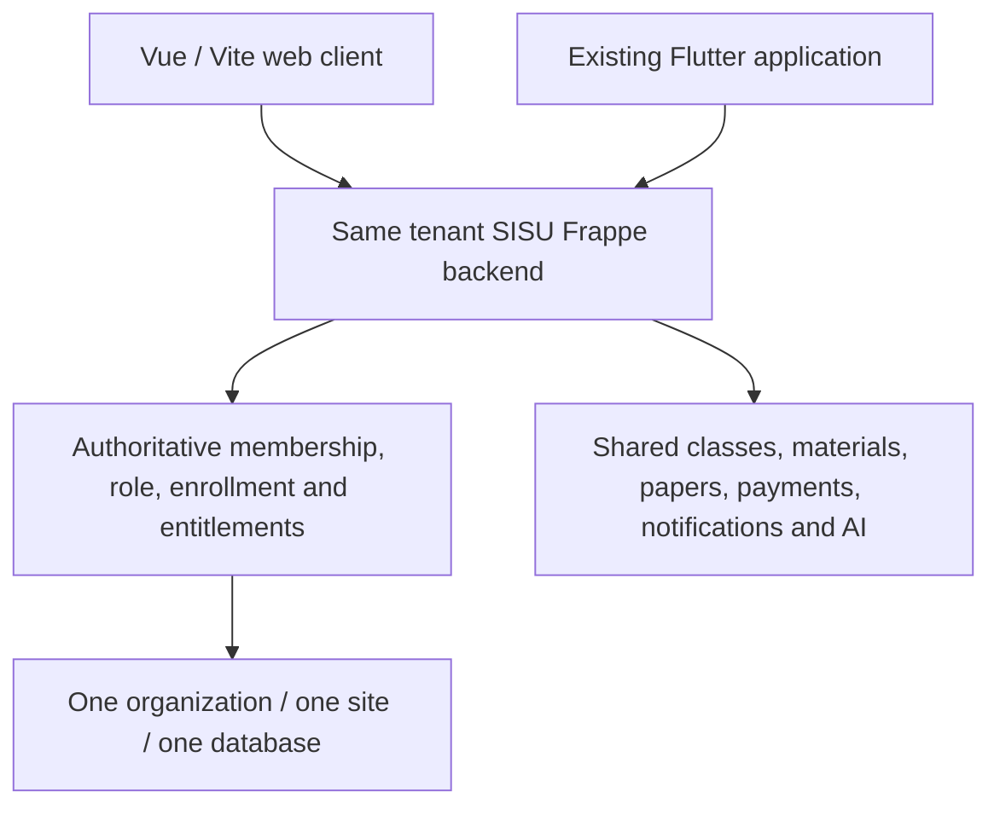

# SISU web and mobile: one backend

The clients must use the same canonical tenant host. Neither Flutter nor Vue creates a replacement Firebase/Supabase backend. Device-local UI state is not a subscription or payment source of truth. Users, courses, enrollments, payments, notifications, knowledge, storage and usage belong to the site's backend records.

## Authentication contracts

Browser: Frappe cookie session, CSRF token for mutations and existing Google student policy. Native client calls centralize error handling in `frontend/src/native/client.js`. Method results are Frappe JSON under `message`; error payloads/statuses must be handled rather than replaced with demo content.

Mobile backend: `mobile_auth.authorize` opens the system-browser login/approval flow with PKCE S256 challenge and state, using only configured redirect URIs and HTTPS. CSRF-protected `approve` issues a short-lived one-use handoff code (120 seconds). `exchange` validates verifier/redirect/device and returns an opaque `Authorization: Sisu <token>` credential with a seven-day expiry. Only its hash is persisted in `IL Mobile Session`. Token requests are limited to `institute_lms.*` method paths and must not mix browser cookies; a shared privileged API key is never required. `mobile_auth.logout` revokes an owned session. Students cannot exchange a non-Google browser session to bypass policy.

This is the implemented backend contract, not a claim that the existing Flutter OAuth flow was fully migrated. The additive mobile parity work preserved existing authentication and added an optional SISU-token integration boundary; completing PKCE, secure device storage, canonical tenant discovery and end-to-end revocation remains the mobile developer's responsibility. See `MOBILE_API_HANDOFF.md` and the separately supplied `MOBILE_PARITY_HANDOFF.md`.

## Shared capabilities and client responsibilities

| Capability | Web implementation | Mobile boundary |
|---|---|---|
| Identity/profile | PortalRoot, profile/private contact APIs | Existing Flutter auth/profile preserved; SISU current/profile contract to connect/verify |
| Classes/materials | App, Classrooms, MaterialViewer; `api.*`, `materials.content` | `mobile_api.classes`, `mobile_api.lesson` and existing authorized methods |
| Enrollments/assessment | Classroom access and Papers | Same scoped enrollments/paper/attempt services; answer-key protection stays server-side |
| Plans/limits | Subscription.vue and `saas.status`/`release.workspace` | Display server flags/limits; do not check plan names as authority |
| Student payments | ClassFees + `payments.checkout` | Hosted payment return followed by trusted server status; no local paid activation |
| Notifications | NotificationCenter; inbox/read/preferences | Same inbox/read/preferences and `devices.register/revoke`; provider acceptance pending |
| OTP | MobileVerification/contact/private-contact UI | SMS/WhatsApp channel, challenge, cooldown and expiry contracts; no persistent OTP |
| AI/RAG | AIWorkspace, Papers feedback | Same AI methods/request IDs and source objects; mobile UI/adapters require connection testing |
| Storage/lifecycle | Server usage and quota/error messages | Display backend usage/access reasons; do not enforce quota independently |

A citation is a SISU source reference (title, material/source type/name, classroom, optional section/page and version). Provider store/file IDs stay internal. A tap must request protected material using the authenticated site contract, not turn an ID into public access.

## Web-first functions

Platform Owner/control-plane administration, organization registry/provisioning, operator readiness and organization checkout/history remain web-first. Advanced administrative configuration and official paper review/publication remain in the established web workflows unless separately integrated in mobile. The mobile parity task did not automatically grant Platform Owner controls or replace existing student payment screens.

Mobile statuses must distinguish locked feature, expired subscription, exhausted quota, provider unavailable, indexing required, unsupported format, insufficient evidence and permission denied. An added screen or adapter means MOBILE READY / MOBILE CONNECTION PENDING where not tested; it does not establish a live connection.

## Handoff acceptance

Use two isolated test tenants and actual Student/Teacher/Admin accounts. Test cross-course denial, expired token, revoked token, lapsed subscription, unpaid class, protected file access, payment return-before-webhook, duplicate AI request, citation open, OTP cooldown and device ownership. Test real push/background/deep-link behavior on devices. This preview validates web rendering only and is never a substitute for that acceptance.
